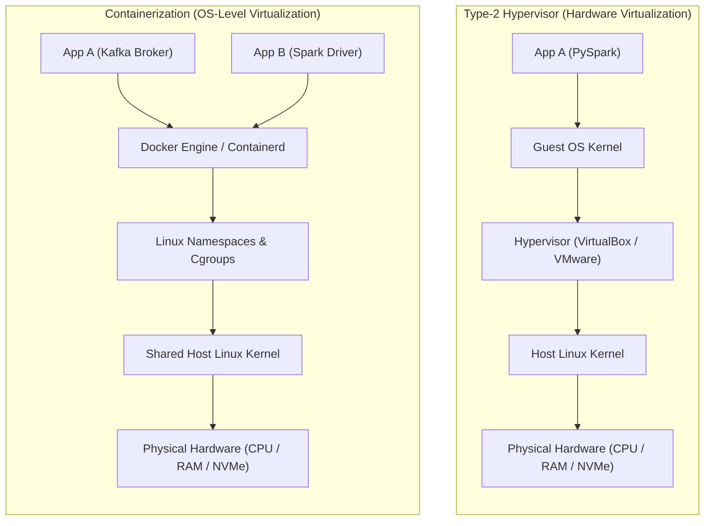
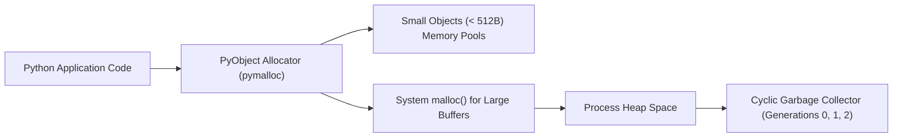
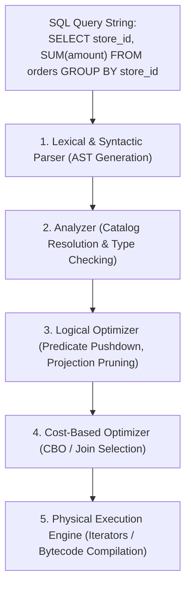

---
**Course:** Enterprise Real-Time Data Engineering  
**Instructor:** Mohamed Fouad Fakhruldeen ([Fakhr.me](https://fakhr.me))  
**Course Portal:** [fakhr.me/KafkaSpark](https://fakhr.me/KafkaSpark)  
**Code & Labs Repository:** [github.com/fakhruldeen/KafkaSpark](https://github.com/fakhruldeen/KafkaSpark)  
---

# Session S00: Student Comprehensive Handbook & Technical Textbook
## Enterprise Engineering Foundations: Linux, Docker, Python & SQL
### Course Orientation & Production Tooling Foundations

---

## 1. Executive Summary & Learning Objectives
Welcome to **Enterprise Real-Time Data Engineering**. Modern stream processing systems like Apache Kafka and distributed analytical engines like Apache Spark do not operate in a vacuum. They are deployed on multi-tenant Linux clusters, packaged into isolated OCI-compliant container runtimes, orchestrated through Infrastructure-as-Code, and interfaced via high-performance programming languages.

In this foundational refresher module, you will master:
1. **Linux Systems Internals:** Kernel vs User space, file descriptor limits, standard streams, signal handling, and process trees.
2. **Docker Containerization Mechanics:** Linux namespaces (`pid`, `net`, `mnt`), control groups (`cgroups`), layered storage drivers, and bridged virtual networking.
3. **High-Performance Python for Data Systems:** Memory model, Global Interpreter Lock (GIL), iterator protocols, generator pipelines, and vectorization.
4. **Relational Database & SQL Execution Foundations:** Relational algebra, ACID transaction isolation levels, Abstract Syntax Tree (AST) parsing, and query execution plans.

---

## 2. Infrastructure Architecture: Containerization vs Virtualization

To deploy and debug distributed data infrastructure, engineers must understand how Docker virtualizes the operating system compared to classical hypervisors.



### 2.1 Linux Kernel Isolation Primitives
Containers are not lightweight virtual machines; they are standard Linux processes running inside isolated kernel sandboxes:
- **Namespaces:** Restrict what a process can *see*.
  - `pid`: Process ID virtualization (process sees itself as PID 1).
  - `net`: Isolated network interfaces, routing tables, and port bindings.
  - `mnt`: Private filesystem mount points.
  - `ipc`: Inter-process communication isolation.
- **Control Groups (cgroups v2):** Restrict what a process can *use*.
  - Enforces hard limits on physical RAM (`memory.max`), CPU cores (`cpu.max`), and disk I/O bandwidth (`io.weight`).
  - Prevents a runaway Spark executor from causing an Out-Of-Memory (OOM) kernel panic on the host machine.

---

## 3. High-Performance Python & Memory Model

When developing data pipelines in Python and PySpark, engineers must understand memory allocation and the execution lifecycle.



### 3.1 The Global Interpreter Lock (GIL) and Distributed Computing
CPython uses reference counting combined with a tri-generational cyclic garbage collector. Because reference count updates are not thread-safe, CPython utilizes the **Global Interpreter Lock (GIL)**:
- In single-node multi-threaded Python, CPU-bound tasks cannot execute in parallel across multiple physical cores.
- **The PySpark Paradigm:** Apache Spark overcomes the GIL entirely by launching independent JVM executor processes across worker nodes, orchestrating tasks across isolated worker subprocesses via IPC domain sockets.

---

## 4. SQL Engine Mechanics: From Query String to Physical Execution Plan

Whether querying PostgreSQL or executing distributed queries in Spark SQL, all SQL engines adhere to a multi-stage compilation pipeline:



### 4.1 Relational Algebra Equivalence
SQL is declarative: you define *what* data is required, not *how* to retrieve it. The optimizer applies mathematical rewrite rules based on relational algebra:
$$\sigma_{\text{amount} > 100} (\pi_{\text{store\_id, amount}} (Orders)) \equiv \pi_{\text{store\_id, amount}} (\sigma_{\text{amount} > 100} (Orders))$$
Pushing the selection operator $\sigma$ down before projecting $\pi$ reduces the memory footprint and network I/O transferred across executor boundaries.

---

## 5. Enterprise Production Troubleshooting Scenarios

### Scenario 1: Container Port Conflict on Local Workstation
- **Symptom:** Running `docker-compose up -d` fails with `Bind for 0.0.0.0:9092 failed: port is already allocated`.
- **Root Cause:** A lingering local Kafka or PostgreSQL service is occupying the target port.
- **Diagnosis:**
  ```bash
  sudo lsof -i :9092 -sTCP:LISTEN
  ```
- **Remediation:** Stop the conflicting local daemon or terminate the orphan process:
  ```bash
  sudo kill -15 <PID>
  ```

### Scenario 2: Python Script Fails with Out-of-Memory (OOM) on Large CSV
- **Symptom:** Process terminated abruptly with `Killed` status from Linux OOM killer.
- **Root Cause:** Ingesting a 5GB CSV directly into memory using `pandas.read_csv()` attempts to materialize contiguous memory buffers 4-5x larger than raw disk size.
- **Remediation:** Convert to a streaming generator or leverage chunked iterators / PySpark:
  ```python
  import csv
  def stream_records(filepath):
      with open(filepath, 'r') as f:
          reader = csv.DictReader(f)
          for row in reader:
              yield row
  ```

---

## 6. Formal Technical Glossary & System Invariants

| Term | Formal Engineering Definition | Architectural Invariant |
|---|---|---|
| **cgroups (Control Groups)** | Linux kernel mechanism for isolating, metering, and limiting resource usage (CPU, memory, disk I/O, network) of process groups. | Hard memory ceiling prevents kernel panic under heavy data ingestion. |
| **Linux Namespace** | Kernel feature that partitions global system resources (process IDs, network interfaces, mount points) into isolated views. | Processes inside container cannot access host processes or unauthorized network sockets. |
| **ACID** | Atomicity, Consistency, Isolation, Durability guarantees enforced by relational database transactions. | Guarantees financial ledger integrity under power failure or software crash. |
| **AST (Abstract Syntax Tree)** | Tree representation of the abstract syntactic structure of source code or SQL queries. | Validates syntax prior to logical plan optimization and schema binding. |
| **Generator / Iterator** | Python construct implementing `__iter__()` and `__next__()` protocols for lazy on-demand evaluation. | Enables processing infinitely large data files in constant $O(1)$ memory. |

---

## 7. Official Documentation & Professional Certification Mapping

### Canonical Documentation Links
- [Linux Kernel Documentation: Control Groups v2](https://www.kernel.org/doc/html/latest/admin-guide/cgroup-v2.html)
- [Docker Engine Architecture Overview](https://docs.docker.com/get-started/overview/)
- [Python 3.10+ Memory Management Internals](https://docs.python.org/3/c-api/memory.html)
- [PostgreSQL Documentation: The Query Execution Engine](https://www.postgresql.org/docs/current/query-path.html)

### Certification Objectives Alignment
- **Confluent CCDAK:** Command-line operations, container networking, cluster connectivity prerequisites.
- **Databricks Spark Associate Developer:** SQL fundamentals, lazy evaluation concepts, data ingestion pipelines.
- **Cloudera Certified Associate (CCA175):** Linux cluster navigation, environment variables, bash scripting automation.
