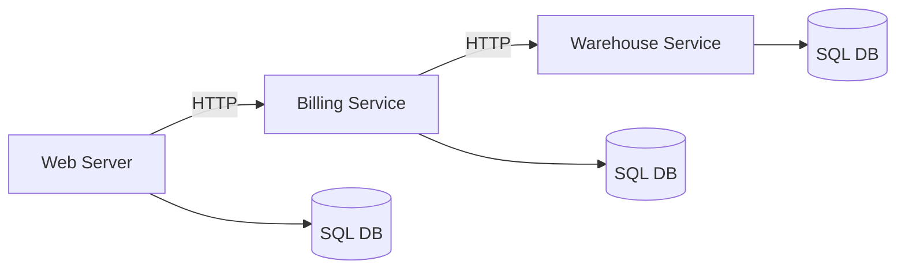
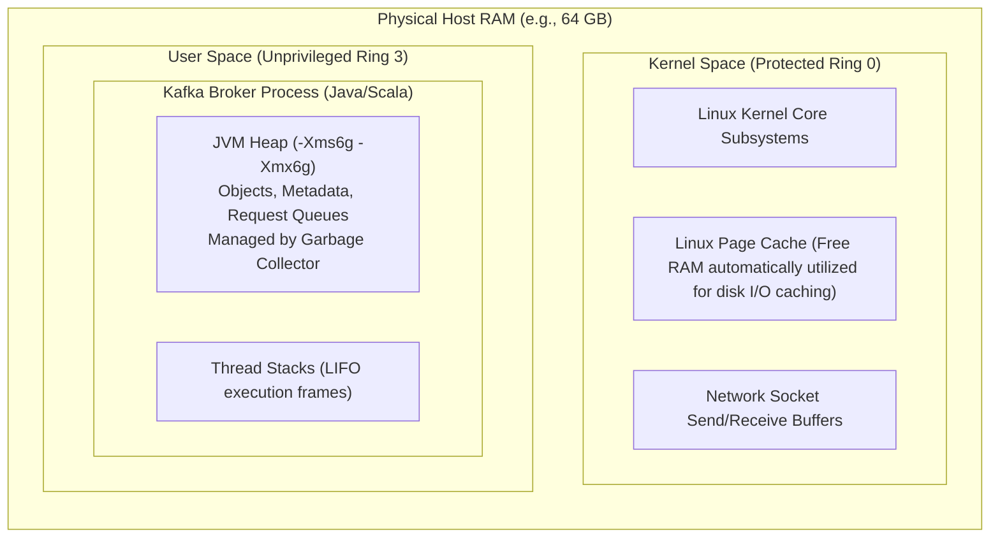
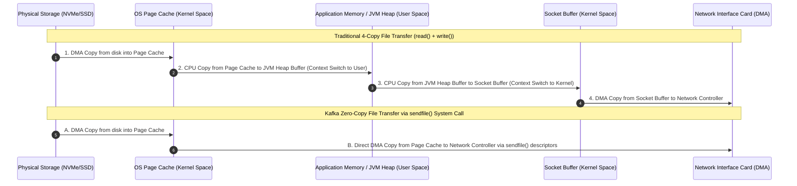
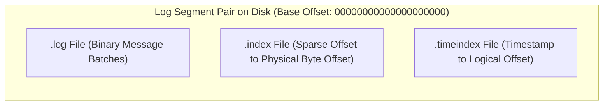
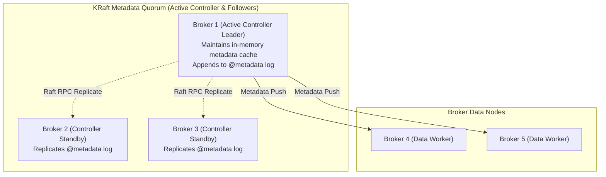

---
**Course:** Enterprise Real-Time Data Engineering  
**Instructor:** Mohamed Fouad Fakhruldeen ([Fakhr.me](https://fakhr.me))  
**Course Portal:** [fakhr.me/KafkaSpark](https://fakhr.me/KafkaSpark)  
**Code & Labs Repository:** [github.com/fakhruldeen/KafkaSpark](https://github.com/fakhruldeen/KafkaSpark)  
---

# Session S01: Student Comprehensive Handbook & Technical Textbook
## Apache Kafka Core & Event Streaming Architecture
### Module 1: Foundations of Distributed Event Systems · Nile Retail Case Study

---

## 1. Architectural Evolution: Why Event Streaming?

### 1.1 The Classical Request-Response Dilemma
For decades, enterprise software was built on the **Synchronous Request-Response** paradigm. In this model, Service A calls Service B over HTTP/REST or a Remote Procedure Call (RPC) and blocks its execution thread while waiting for a response. When Service B finishes writing to its relational database (RDBMS), it returns HTTP 200 OK, and Service A continues.

In a small enterprise, this architecture works reliably. However, as business operations scale, three catastrophic failure modes emerge:



1. **Tight Temporal Coupling:** If the Warehouse Service slows down or crashes during a peak traffic event, the Billing Service thread hangs. This causes the Web Server thread pool to exhaust, resulting in site-wide outages (HTTP 504 Gateway Timeout).
2. **Data Duplication & Synchronization Hell:** When an order changes state, multiple downstream databases (analytics, inventory, CRM, financial auditing) must be updated. Coordinating these updates across separate databases requires Distributed Two-Phase Commits (2PC), which are notoriously slow, fragile, and prone to distributed deadlocks.
3. **Loss of Historical Intent:** In traditional RDBMS tables, updating an entity destroys its past state:
   ```sql
   UPDATE orders SET status = 'SHIPPED' WHERE order_id = 10049;
   ```
   Unless the developer writes custom audit-log tables or triggers, the database only knows what the order is *now*, completely losing the rich sequence of business facts: *When was the item packed? How long did it wait for the courier? How many times did payment fail before succeeding?*

---

## 2. The Core Scientific Paradigm: State vs. Events

To understand Apache Kafka, you must understand the mathematical duality between **State** and a **Stream of Events**:

> **Definition (Event):** An event is an immutable, chronologically ordered record of a fact that has indisputably occurred in the real world.

| Dimension | State-Oriented System (Relational DB) | Event-Oriented System (Apache Kafka) |
|---|---|---|
| **Core Entity** | Tables containing current values. | An append-only log of historical facts. |
| **Modification Model** | In-place destructive overwrite (`UPDATE`, `DELETE`). | Append-only (`INSERT` / append at the end of the log). |
| **Data Mutability** | Highly mutable. | Completely **immutable** (written once, never edited). |
| **Read Impact** | Reads can cause table or row locks. | Reads are passive sequential scans; reading **never deletes** or locks. |
| **Consumer Decoupling** | Consumers poll the database, risking query exhaustion. | Producers emit facts once; unlimited independent consumers read asynchronously. |

$$\text{Current State} = \sum_{t=0}^{T} \text{Event}_t$$

**The Fundamental Law of Event Sourcing:** The current state of any business system is simply the mathematical accumulation (or fold) of all events that have occurred from the beginning of time up to the current moment.

### Worked Numeric Walkthrough: Event Log to Materialized State
Consider customer `CUST-101`'s wallet account balance starting at initial state $B_0 = 0\text{ EGP}$. The append-only commit log records the following immutable event sequence:

1. $E_1$: `WalletFunded` $(+500\text{ EGP})$ $\rightarrow B_1 = 0 + 500 = 500\text{ EGP}$
2. $E_2$: `OrderPlaced` $(-120\text{ EGP})$ $\rightarrow B_2 = 500 - 120 = 380\text{ EGP}$
3. $E_3$: `OrderPlaced` $(-80\text{ EGP})$ $\rightarrow B_3 = 380 - 80 = 300\text{ EGP}$
4. $E_4$: `ItemReturned` $(+80\text{ EGP})$ $\rightarrow B_4 = 300 + 80 = 380\text{ EGP}$

An RDBMS table only displays the final number `380 EGP`. If an auditor asks why the balance is 380 EGP, the database cannot prove it without secondary logs. In Kafka, the log is the single source of truth; any service can replay the log to reconstruct state at any millisecond in history.

---

## 3. Deep Systems Architecture & Operating System Mechanics

### 3.1 Memory Layout: Physical RAM, Kernel Space, and JVM Heap

To grasp why Kafka achieves multi-gigabyte throughput per node, one must understand how the Linux operating system and the Java Virtual Machine manage physical memory.



### 3.2 The Zero-Copy Data Transfer Protocol (`sendfile()`)

In traditional network servers, sending data from a file on disk to a network client requires 4 context switches between User Space and Kernel Space, and 4 data copies across memory buffers:



1. Traditional pipeline:
   - Data is copied from disk to the OS Page Cache via Direct Memory Access (DMA).
   - CPU copies data from Page Cache across the boundary into the JVM Heap (User Space).
   - CPU copies data from JVM Heap into the socket buffer in Kernel Space.
   - DMA engine copies data from socket buffer to the Network Interface Card (NIC).
2. Kafka Zero-Copy pipeline:
   - Kafka brokers bypass the JVM Heap entirely for message transfer using the Linux `sendfile()` system call.
   - The OS kernel transmits bytes directly from the Page Cache to the NIC buffer via DMA descriptor gathering.
   - The JVM never allocates byte arrays, completely eliminating Garbage Collection (GC) pauses and CPU memory copy overhead.

### 3.3 Disk I/O Mechanics: Sequential vs Random Access
Traditional wisdom claims disk storage is slow. However, disk performance depends strictly on access pattern:
- **Random Disk I/O:** Reading or updating arbitrary blocks on spinning magnetic disks requires physical arm actuator movement (rotational latency + seek time $\approx 10\text{ ms}$), achieving barely $\sim 100\text{ KB/s}$ to $1\text{ MB/s}$. Even on enterprise NVMe SSDs, random writes cause write amplification and block-erase latency.
- **Sequential Disk I/O:** Appending bytes sequentially to the end of a file leverages OS track lookahead and large contiguous sector writes, consistently saturating the bus at $600\text{ MB/s}$ on SAS drives and $> 3.5\text{ GB/s}$ on NVMe PCIe Gen4 SSDs.

Because Kafka writes to an **immutable append-only Commit Log**, its disk I/O performance rivals direct memory access.

---

## 4. Physical Storage Mechanics: Log Segments and Sparse Indexes

Each Kafka partition is physically stored on disk as a directory containing ordered **Log Segments**. A segment consists of three interdependent files:



1. **`00000000000000000000.log`:** The raw binary append-only commit log containing serialized `RecordBatch` envelopes.
2. **`00000000000000000000.index` (Sparse Index):** Kafka does not create an index entry for every single message. Instead, it writes an index entry every $4\text{ KB}$ (configured via `index.interval.bytes = 4096`).
   - Each index entry is exactly 8 bytes: 4 bytes relative offset + 4 bytes physical file position.
   - Searching for an offset executes a rapid in-memory binary search over the `.index` file to locate the closest lower byte position, followed by a short sequential scan over the `.log` file.
3. **`00000000000000000000.timeindex`:** Maps event timestamps (`CreateTime` or `LogAppendTime`) to logical offsets, enabling time-based search (`offsetsForTimes()`).

### Segment Rolling Triggers
A segment is closed (rolled) and a new active segment is created when either condition is met:
- Physical file size reaches `segment.bytes` (default $1\text{ GB}$).
- Segment age reaches `segment.ms` (default 7 days).

---

## 5. Modern Cluster Consensus: Apache Kafka Raft (KRaft)

Historically, Apache Kafka relied on Apache ZooKeeper to manage cluster metadata, broker registration, and leader election. ZooKeeper suffered from serious scaling limitations: metadata synchronization was bottlenecked, cluster recovery with millions of partitions took tens of minutes, and operating two separate distributed systems increased operational complexity.

Under **KRaft (KIP-500)**, Kafka manages its own metadata quorum internally using an event-driven variant of the Raft consensus protocol.



- Metadata is stored as an internal compacted Kafka topic called `@metadata`.
- The **Active Controller Leader** appends metadata changes directly to this log and pushes updates to all brokers via high-performance RPCs.
- Failover takes milliseconds instead of minutes because standby controllers already have the entire metadata state loaded in memory.

---

## 6. Enterprise Production Troubleshooting Scenarios

### Scenario 1: Broker Memory Exhaustion & OOM Panic
- **Symptom:** Kafka broker process crashes with `java.lang.OutOfMemoryError: Java heap space`.
- **Root Cause:** Inexperienced administrators configured `-Xmx32g` or `-Xmx64g`, leaving insufficient memory for the Linux Page Cache. The JVM Garbage Collector suffered massive Stop-the-World pauses, causing the KRaft controller to mark the broker dead.
- **Remediation:** Set Kafka JVM heap to a modest size (e.g. `6 GB` to `8 GB`) using G1GC, dedicating the remaining $75\%+$ of physical RAM to the OS Page Cache:
  ```bash
  export KAFKA_HEAP_OPTS="-Xms6g -Xmx6g -XX:+UseG1GC -XX:MaxGCPauseMillis=20 -XX:InitiatingHeapOccupancyPercent=35"
  ```

### Scenario 2: High Disk Latency on Random Seek
- **Symptom:** Broker I/O wait spikes, producer latency increases by $10\times$.
- **Root Cause:** Multiple consumers are reading historical data from weeks ago simultaneously, evicting the active tail of the log from the Linux Page Cache and forcing physical disk seeks.
- **Remediation:** Isolate cold analytical batch consumers to dedicated read replicas or scale OS RAM to hold the active working set.

---

## 7. Formal Technical Glossary & System Invariants

| Term | Formal Engineering Definition | Architectural Invariant |
|---|---|---|
| **Commit Log** | An append-only, ordered sequence of immutable records stored durably on persistent media. | Records can only be appended at the end; past records are immutable. |
| **Page Cache** | Transparent OS memory cache that stores disk pages in unused physical RAM. | Maximizes read/write throughput without JVM memory overhead. |
| **Zero-Copy** | Direct data path from storage Page Cache to network buffer via `sendfile()`. | Eliminates CPU data copying and Garbage Collection pressure. |
| **Sparse Index** | Index structure containing pointers to memory/disk blocks at regular byte intervals rather than indexing every record. | Keeps memory footprint negligible while maintaining $O(\log N)$ search speed. |
| **KRaft** | Built-in Raft consensus protocol managing Kafka cluster metadata without external ZooKeeper dependencies. | Single-tier architecture enabling sub-second controller leader failovers. |

---

## 8. Canonical Documentation & Industry Certification Roadmap

### Canonical Documentation Links
- [Apache Kafka Official Documentation: Design and Storage Internals](https://kafka.apache.org/documentation/#design)
- [Linux Man Pages: sendfile(2) Zero-Copy System Call](https://man7.org/linux/man-pages/man2/sendfile.2.html)
- [Confluent Documentation: KRaft Overview and Architecture](https://docs.confluent.io/platform/current/kraft.html)

### Certification Objectives Alignment (Confluent CCDAK)
- **Domain 1: Kafka Architecture:** Log segments, sparse indexes, broker storage configuration.
- **Domain 2: Hardware Sizing:** RAM allocation, Page Cache ratio, sequential disk I/O optimization.
- **Domain 3: KRaft Operations:** Quorum controllers, voter roles, metadata replication.
