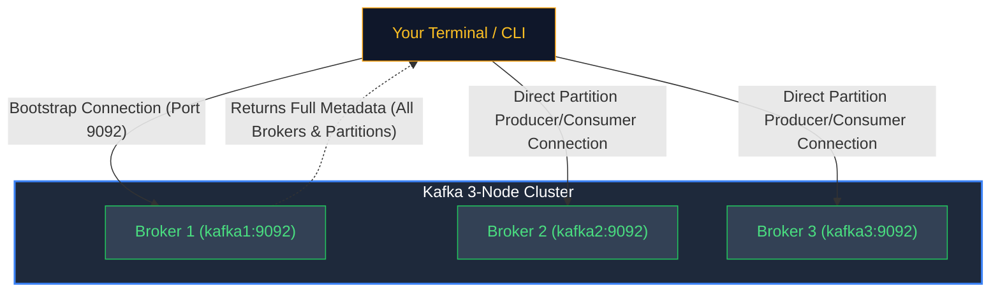

---
**Course:** Enterprise Real-Time Data Engineering  
**Instructor:** Mohamed Fouad Fakhruldeen ([Fakhr.me](https://fakhr.me))  
**Course Portal:** [fakhr.me/KafkaSpark](https://fakhr.me/KafkaSpark)  
**Code & Labs Repository:** [github.com/fakhruldeen/KafkaSpark](https://github.com/fakhruldeen/KafkaSpark)  
---

# Session S01: Hands-On Lab Walkthrough & CLI Guide
## Practical Step-by-Step Instructor & Trainee Guide

---

<!-- SLIDE 1: LAB OVERVIEW -->
# Lab S01: Environment Orientation & Kafka CLI Mastery
**Duration: 90 Minutes · Mode: Hands-on Terminal**

### What We Are Building:
In this lab, you will interact directly with the Nile Retail 3-node Kafka cluster. You will create partitioned topics, publish real business transactions using the command-line producer, and verify how Kafka stores, offsets, and persists events without deleting them.



---

<!-- SLIDE 2: VERIFY ENVIRONMENT -->
# Step 1: Verify the Lab Environment

Open your terminal and confirm that the multi-broker Kafka stack is running and healthy:

```bash
# Check running Docker containers
docker ps --format "table {{.Names}}\t{{.Status}}\t{{.Ports}}"
```

#### Expected Output:
You should see 3 Kafka broker containers (`kafka1`, `kafka2`, `kafka3`) reporting `healthy`, alongside companion services (`schema-registry`, `postgres`, `kafka-ui`):

```
NAMES             STATUS                   PORTS
kafka1            Up 10 minutes (healthy)  0.0.0.0:9092->9094/tcp
kafka2            Up 10 minutes (healthy)  0.0.0.0:9093->9094/tcp
kafka3            Up 10 minutes (healthy)  0.0.0.0:9094->9094/tcp
```

> **Key Learning:** The cluster uses port `9092` as the primary external bootstrap port from your host machine, while internal containers communicate via `kafka1:9092`.

---

<!-- SLIDE 3: CREATE TOPIC -->
# Step 2: Creating Your First Partitioned Topic

Run the `kafka-topics.sh` command to create the `retail.orders.lab` topic with **3 partitions** and a **replication factor of 3**:

```bash
docker exec -it kafka1 /opt/kafka/bin/kafka-topics.sh \
  --bootstrap-server kafka1:9092 \
  --create \
  --topic retail.orders.lab \
  --partitions 3 \
  --replication-factor 3
```

#### Expected Output:
```text
Created topic retail.orders.lab.
```

#### Verify Topic Creation:
```bash
docker exec -it kafka1 /opt/kafka/bin/kafka-topics.sh \
  --bootstrap-server kafka1:9092 \
  --list
```

---

<!-- SLIDE 4: DESCRIBE TOPIC METADATA -->
# Step 3: Inspecting Topic Partitions & Leaders

To understand how Kafka distributes data across servers, run the `--describe` command:

```bash
docker exec -it kafka1 /opt/kafka/bin/kafka-topics.sh \
  --bootstrap-server kafka1:9092 \
  --describe \
  --topic retail.orders.lab
```

#### Expected Output:
```text
Topic: retail.orders.lab	TopicId: aBcDeF12345	PartitionCount: 3	ReplicationFactor: 3	Configs: min.insync.replicas=2
	Topic: retail.orders.lab	Partition: 0	Leader: 1	Replicas: 1,2,3	Isr: 1,2,3
	Topic: retail.orders.lab	Partition: 1	Leader: 2	Replicas: 2,3,1	Isr: 2,3,1
	Topic: retail.orders.lab	Partition: 2	Leader: 3	Replicas: 3,1,2	Isr: 3,1,2
```

#### What This Output Tells You (Explain to Students):
* **Partition 0, 1, 2:** The topic is divided into 3 independent slices.
* **Leader:** The broker actively accepting writes and reads for that slice (e.g. Broker 1 leads Partition 0).
* **Replicas: 1,2,3:** All 3 brokers hold a physical copy of this partition on their disk.
* **Isr (In-Sync Replicas):** Replicas that are completely caught up with the leader. If Leader 1 dies, Kafka immediately promotes Broker 2 or 3!

---

<!-- SLIDE 5: CONSOLE PRODUCER -->
# Step 4: Producing Events with Keys & Values

Kafka records typically carry a **Key** (for routing) and a **Value** (the business payload). Launch the console producer configured with a colon (`:`) separator:

```bash
docker exec -it kafka1 /opt/kafka/bin/kafka-console-producer.sh \
  --bootstrap-server kafka1:9092 \
  --topic retail.orders.lab \
  --property "parse.key=true" \
  --property "key.separator=:"
```

#### Type the following 3 orders into the terminal, pressing Enter after each:
```text
CUST-101:{"order_id": 1, "item": "Smart TV", "amount": 14000}
CUST-102:{"order_id": 2, "item": "Espresso Machine", "amount": 6500}
CUST-101:{"order_id": 3, "item": "HDMI Cable", "amount": 250}
```

*(Press `Ctrl + C` to exit the producer once typed)*

---

<!-- SLIDE 6: CONSOLE CONSUMER -->
# Step 5: Consuming Events & Inspecting Metadata

Now, inspect how Kafka stored these records across partitions and offsets:

```bash
docker exec -it kafka1 /opt/kafka/bin/kafka-console-consumer.sh \
  --bootstrap-server kafka1:9092 \
  --topic retail.orders.lab \
  --from-beginning \
  --property print.key=true \
  --property print.partition=true \
  --property print.offset=true \
  --property print.timestamp=true
```

#### Expected Output:
```text
CreateTime:1730818900123	Partition:1	Offset:0	CUST-102	{"order_id": 2, "item": "Espresso Machine", "amount": 6500}
CreateTime:1730818900010	Partition:2	Offset:0	CUST-101	{"order_id": 1, "item": "Smart TV", "amount": 14000}
CreateTime:1730818900250	Partition:2	Offset:1	CUST-101	{"order_id": 3, "item": "HDMI Cable", "amount": 250}
```

#### Notice the Crucial Scientific Insights:
1. **Key Hashing in Action:** Both orders for `CUST-101` were routed to the exact same partition (**Partition 2**) at sequential offsets (**0 and 1**). Records with the same key go to the same partition, so they are read in offset order (the order the broker appended them, not necessarily event-time order in the business). Ordering is guaranteed strictly within a partition.
2. **Re-Readability:** Press `Ctrl + C`, run the exact same consumer command again, and observe: **All 3 events are printed again!** Reading does not delete data.

---

<!-- SLIDE 7: TROUBLESHOOTING & COMMON PITFALLS -->
# Step 6: Troubleshooting & Common Pitfalls

| Symptom | Cause | Fix |
|---|---|---|
| `TimeoutException: Call timed out after 60000ms` | Wrong port used (e.g. typing `9092` inside container instead of `kafka1:9092`). | Inside Docker, use `kafka1:9092`. From host terminal, use `localhost:9092`. |
| `TopicExistsException: Topic already exists` | The topic was previously created. | Expected if re-running. Use `--describe` or delete with `--delete`. |
| `Consumer hangs with no output` | Forgot `--from-beginning` flag. | By default, consumers only read **new** events arriving after the consumer connects. Always add `--from-beginning` when inspecting existing records! |

---

<!-- SLIDE 8: PASS CRITERIA -->
# Lab S01 Validation Checklist (PASS Gate)

To mark Lab S01 as **COMPLETE (PASS)**, verify:
- [ ] Topic `retail.orders.lab` exists with 3 partitions and replication factor 3.
- [ ] The describe output lists an elected Leader and all 3 ISRs (`1,2,3`).
- [ ] At least 3 keyed events were successfully produced.
- [ ] The consumer successfully displayed keys, partition numbers, and sequential offsets.

---

---

## 🌟 Gold Stretch Challenge: Physical Log Segment Inspection & Dump
> **Distinguished Engineer Challenge:** If you complete the core lab before time expires, perform this physical disk inspection:
1. Attach an interactive shell inside the Kafka broker container and inspect the physical disk storage of the commit log:
   ```bash
   docker exec -it kafka1 ls -la /tmp/kraft-combined-logs/retail.orders-0/
   ```
2. Use the official `kafka-run-class.sh` utility to disassemble and dump the binary contents of the `.log` file:
   ```bash
   docker exec -it kafka1 /opt/kafka/bin/kafka-run-class.sh kafka.tools.DumpLogSegments      --files /tmp/kraft-combined-logs/retail.orders-0/00000000000000000000.log      --print-data-log --verify-index-only
   ```
3. Observe how each record is decoded with its physical byte offset, `CreateTime` timestamp, Magic Byte (`0x02` for RecordBatch), CRC checksum, key size, and payload payload length.
