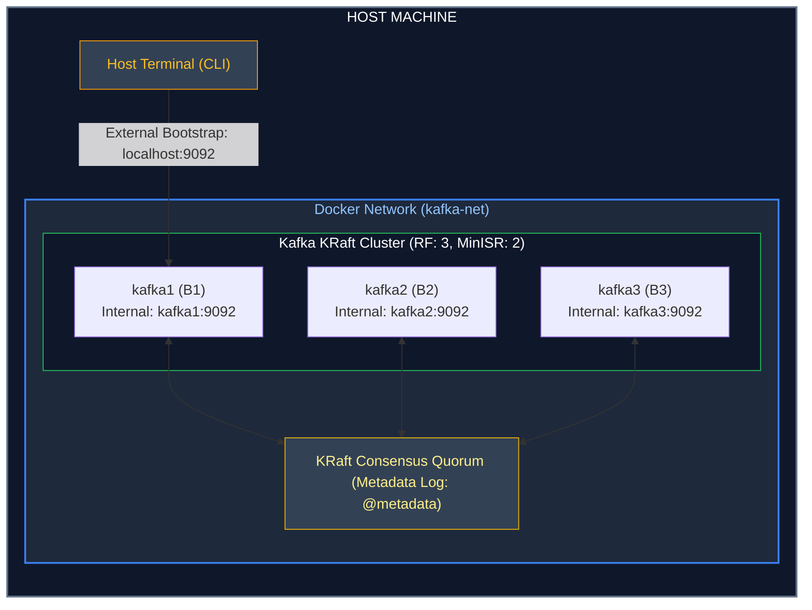

---
**Course:** Enterprise Real-Time Data Engineering  
**Instructor:** Mohamed Fouad Fakhruldeen ([Fakhr.me](https://fakhr.me))  
**Course Portal:** [fakhr.me/KafkaSpark](https://fakhr.me/KafkaSpark)  
**Code & Labs Repository:** [github.com/fakhruldeen/KafkaSpark](https://github.com/fakhruldeen/KafkaSpark)  
---

# Lab S01: Kafka Environment & Core CLI Mastery
## Student Hands-on Lab Guide & Validation Manual
**Course:** Apache Kafka Core, Confluent Developer & Apache Spark  
**Module:** Module 1 (Session S01)  
**Estimated Time:** 90 Minutes

---

## 1. Lab Objectives

By completing this hands-on lab, you will be able to:
1. **Verify your local Docker multi-broker cluster** using the automated test suite.
2. **Provision Kafka topics** with custom partition counts and replication factors using the Kafka CLI tools.
3. **Inspect cluster metadata** and identify Partition Leaders, Replicas, and In-Sync Replicas (ISR).
4. **Publish keyed business records** to Kafka using `kafka-console-producer.sh`.
5. **Consume records with detailed metadata** (keys, timestamps, partitions, offsets) using `kafka-console-consumer.sh`.
6. **Verify the non-destructive log principle**: Prove that consuming events does not delete them from storage.

---

## 2. Lab Architecture & Network Topology

All exercises in this lab run against the local multi-container KRaft cluster:



> **IMPORTANT NETWORKING RULE:**
> * When executing commands **inside Docker** (e.g. via `docker exec kafka1 ...`), the bootstrap server address is **`kafka1:9092`**.
> * When executing commands from your **local host machine terminal**, the bootstrap server address is **`localhost:9092`**.

---

## 3. Step-by-Step Practical Exercises

### Exercise 1: Cluster Health Verification (Gate 0)
Before creating any topics, confirm that all services in your lab environment report **PASS**.

Run the following command from the repository root:
```bash
make check
```

#### Expected Output:
```text
PASS  kafka cluster (3 brokers reachable)
PASS  schema registry
PASS  kafka connect
PASS  ksqldb server
PASS  postgres
PASS  kafka ui
```
> If any service fails, consult Section 4 (Troubleshooting) before continuing.

---

### Exercise 2: Create a Partitioned Topic
You are a data engineer at Nile Retail. You need to create a new topic for order transactions named `retail.orders.lab` with **3 partitions** and a **replication factor of 3**.

Run the topic creation command inside broker container `kafka1`:
```bash
docker exec -it kafka1 /opt/kafka/bin/kafka-topics.sh \
  --bootstrap-server kafka1:9092 \
  --create \
  --topic retail.orders.lab \
  --partitions 3 \
  --replication-factor 3 \
  --if-not-exists
```

#### Expected Output:
```text
Created topic retail.orders.lab.
```

Verify that the topic appears in the cluster's topic inventory:
```bash
docker exec -it kafka1 /opt/kafka/bin/kafka-topics.sh \
  --bootstrap-server kafka1:9092 \
  --list
```

---

### Exercise 3: Inspect Topic Metadata & Leadership
Run the `--describe` command to view how the cluster allocated the partitions across physical broker nodes:

```bash
docker exec -it kafka1 /opt/kafka/bin/kafka-topics.sh \
  --bootstrap-server kafka1:9092 \
  --describe \
  --topic retail.orders.lab
```

#### Expected Output:
```text
Topic: retail.orders.lab	TopicId: aBc123XyZ	PartitionCount: 3	ReplicationFactor: 3	Configs: min.insync.replicas=2
	Topic: retail.orders.lab	Partition: 0	Leader: 1	Replicas: 1,2,3	Isr: 1,2,3
	Topic: retail.orders.lab	Partition: 1	Leader: 2	Replicas: 2,3,1	Isr: 2,3,1
	Topic: retail.orders.lab	Partition: 2	Leader: 3	Replicas: 3,1,2	Isr: 3,1,2
```

#### Analysis Questions:
1. Which broker is the Leader for Partition 1? *(In the output above: Broker 2).*
2. What does `Isr: 1,2,3` mean? *(All 3 broker replicas are completely caught up with writes).*

---

### Exercise 4: Publishing Keyed Order Events
Start the interactive command-line producer. We configure `--property parse.key=true` and `--property key.separator=:` so that we can supply a partition key followed by a colon and the JSON payload:

```bash
docker exec -it kafka1 /opt/kafka/bin/kafka-console-producer.sh \
  --bootstrap-server kafka1:9092 \
  --topic retail.orders.lab \
  --property "parse.key=true" \
  --property "key.separator=:"
```

Once the `>` prompt appears, copy and paste the following 3 records (press Enter after each record):
```text
CUST-101:{"order_id": 1, "item": "Smart TV", "amount": 14000}
CUST-102:{"order_id": 2, "item": "Espresso Machine", "amount": 6500}
CUST-101:{"order_id": 3, "item": "HDMI Cable", "amount": 250}
```

Press **`Ctrl + C`** to exit the producer.

---

### Exercise 5: Consuming with Full Metadata
Start the console consumer. We add `--from-beginning` to read historical data, and enable flags to print the key, partition, offset, and timestamp:

```bash
docker exec -it kafka1 /opt/kafka/bin/kafka-console-consumer.sh \
  --bootstrap-server kafka1:9092 \
  --topic retail.orders.lab \
  --from-beginning \
  --property print.key=true \
  --property print.partition=true \
  --property print.offset=true \
  --property print.timestamp=true
```

#### Expected Output:
```text
CreateTime:1730818900123	Partition:1	Offset:0	CUST-102	{"order_id": 2, "item": "Espresso Machine", "amount": 6500}
CreateTime:1730818900010	Partition:2	Offset:0	CUST-101	{"order_id": 1, "item": "Smart TV", "amount": 14000}
CreateTime:1730818900250	Partition:2	Offset:1	CUST-101	{"order_id": 3, "item": "HDMI Cable", "amount": 250}
```

> **CRITICAL OBSERVATION:**  
> Look at the partition numbers! Notice that **both orders for `CUST-101` were routed to the exact same partition (Partition 2)** at sequential offsets (`0` and `1`). Records with the same key go to the same partition, so they are read in offset order. Offset order is the order the broker appended them, not necessarily the order events happened in the business. Ordering is guaranteed only within a partition.

---

### Exercise 6: Verifying Non-Destructive Storage
Press `Ctrl + C` to exit the consumer.

Now, run the exact same consumer command from Exercise 5 a second time:
```bash
docker exec -it kafka1 /opt/kafka/bin/kafka-console-consumer.sh \
  --bootstrap-server kafka1:9092 \
  --topic retail.orders.lab \
  --from-beginning \
  --property print.key=true \
  --property print.offset=true
```

#### What happens?
**All 3 records are printed again!**
Unlike RabbitMQ or traditional message queues, **reading from Kafka does not consume or delete messages**.

---

## 4. Troubleshooting & Diagnostic Guide

| Error Message | Root Cause | Solution |
|---|---|---|
| `TimeoutException: Call timed out after 60000ms` | You passed `localhost:9092` while running inside a container, or `kafka1:9092` from the host. | Match the network context: inside Docker use `kafka1:9092`; from host terminal use `localhost:9092`. |
| `TopicExistsException: Topic 'retail.orders.lab' already exists` | The topic was already created in a previous run. | This is harmless. Add `--if-not-exists` or use `--describe` to inspect it. |
| `Consumer hangs with no output displayed` | The consumer is waiting for *new* messages. | Add `--from-beginning` to tell Kafka to start reading from Offset 0. |

---

## 5. Automated PASS Verification Gate

When you have completed all exercises, run the automated verification script:

```bash
./delivery_materials/S01_Kafka_Foundations/Trainer/verify_s01.sh
```

If your configuration is correct, you will see:
```text
==================================================
  PASS: S01 Lab Requirements Satisfied!
  - Topic retail.orders.lab exists
  - Partition count = 3, Replication factor = 3
  - All 3 In-Sync Replicas verified
  - Keyed records produced and consumed successfully
==================================================
```


---
*Enterprise Real-Time Data Engineering · Instructor: Mohamed Fouad Fakhruldeen ([Fakhr.me](https://fakhr.me)) · Course Materials: [fakhr.me/KafkaSpark](https://fakhr.me/KafkaSpark) · Repository: [github.com/fakhruldeen/KafkaSpark](https://github.com/fakhruldeen/KafkaSpark)*
