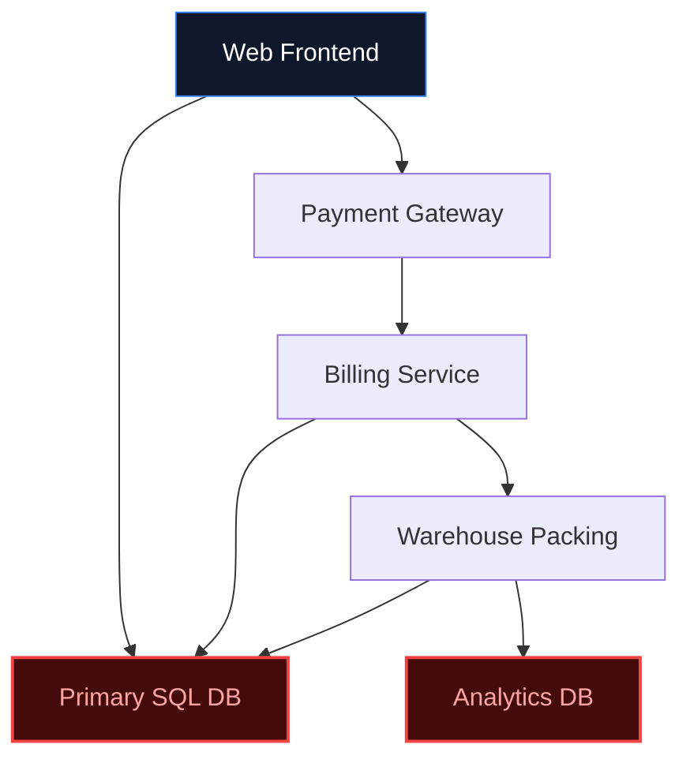
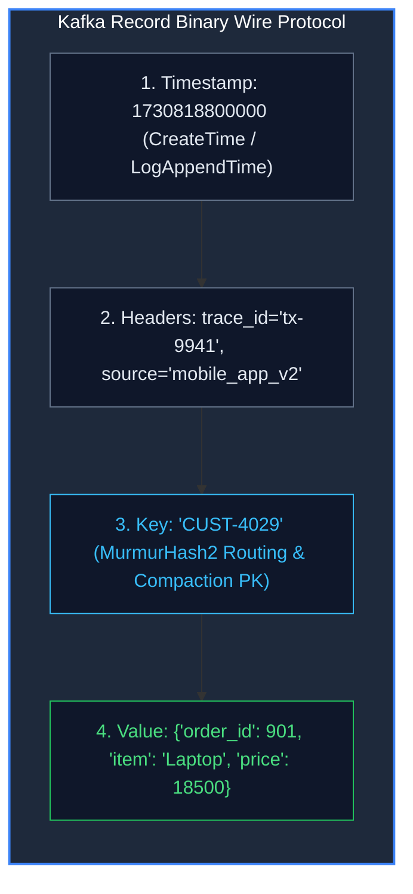
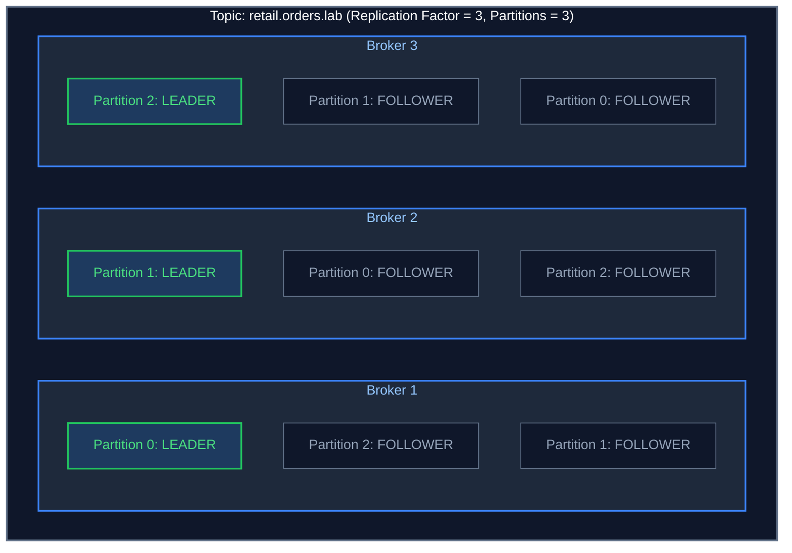

---
**Course:** Enterprise Real-Time Data Engineering  
**Instructor:** Mohamed Fouad Fakhruldeen ([Fakhr.me](https://fakhr.me))  
**Course Portal:** [fakhr.me/KafkaSpark](https://fakhr.me/KafkaSpark)  
**Code & Labs Repository:** [github.com/fakhruldeen/KafkaSpark](https://github.com/fakhruldeen/KafkaSpark)  
---

# S01: Kafka Foundations & Event Streaming Architecture
## Student Technical Reference & Slide Companion
**Module 1 · Session S01 · 3 Contact Hours**  
**Course:** Apache Kafka Core, Confluent Developer & Apache Spark

---

<!-- SLIDE 1 -->
# S01: Apache Kafka Foundations & Event Streaming
### From Request-Response to Distributed Event Logs

#### Session Purpose:
To transition your engineering mental model from state-oriented databases to immutable, distributed event-driven architectures. By the end of this session, you will understand the historical origins, mathematical principles, physical storage mechanics, and core CLI operations of Apache Kafka.

---

<!-- SLIDE 2 -->
# Historical Background: How & Why Kafka Was Born
### The Engineering Crisis at LinkedIn (2010)

* **The Problem at LinkedIn:** In 2010, LinkedIn's active user base exploded. The website generated billions of discrete user activity interactions daily: profile views, connection requests, search queries, and ad impressions.
* **The Failure of Traditional Tech:** LinkedIn initially used enterprise message brokers (ActiveMQ) and relational databases (Oracle). As queues grew, memory buffers overflowed, broker threads locked up, and database replication crashed under the write volume.
* **The Inventors:** Three senior engineers—**Jay Kreps, Neha Narkhede, and Jun Rao**—realized that traditional message queues were solving the wrong problem. They needed a distributed, append-only log that could persist petabytes of data on standard commodity disks.
* **The Origin of the Name:** Jay Kreps named the project after the 20th-century author **Franz Kafka**. Why? *"Since Kafka was a system optimized for writing, using a writer's name made total sense."*
* **Open Source & Enterprise:** Open-sourced to the Apache Software Foundation in 2011. In 2014, the founders launched **Confluent** to expand enterprise streaming. Today, Kafka powers over 80% of the Fortune 100.

---

<!-- SLIDE 3 -->
# The Business Case: Nile Retail on Black Friday
### What Happens When Modern Scale Hits Synchronous Architectures



* **The Black Friday Surge:** Nile Retail (Egypt's major online store) launched a flash sale at 10:00 AM. In the first 60 minutes, **240,000 orders** hit the system (4,000 orders every minute).
* **The Catastrophic Breakdown:**
  1. **HTTP 504 Gateway Outages:** The web checkout service hung because the central PostgreSQL database ran out of connection pools.
  2. **The "Lost" 300 Orders:** The payment gateway successfully charged 300 customers, but the warehouse service was overwhelmed and slow. The orders were marked "Paid" in billing, but never appeared in the packing queue.
  3. **The Executive Blind Spot:** When the CEO asked for total revenue generated between 10:00 AM and 10:30 AM, running the SQL aggregation query locked the production tables for 2 hours.

---

<!-- SLIDE 4 -->
# The Architectural Paradigm Shift
### Request-Response (Commands) vs. Event Streaming (Facts)

| Architectural Dimension | Traditional Request-Response | Event Streaming (Apache Kafka) |
|---|---|---|
| **Communication Style** | **Commands:** *"Please do this for me."* | **Facts:** *"This has already happened."* |
| **Execution Coupling** | **Synchronous:** Service A blocks while waiting for Service B. | **Asynchronous:** Service A emits a fact and immediately moves on. |
| **System Dependency** | High: If downstream services fail, upstream fails. | Zero: Producers don't know who reads or how many readers exist. |
| **Data Consumption** | Consumers poll the database (`SELECT ... WHERE status='PENDING'`). | Consumers reactively stream events at their own processing speed. |
| **Historical Replay** | Impossible without custom database backup restores. | Trivially easy: Rewind the offset bookmark to replay from Day 1. |

---

<!-- SLIDE 5 -->
# Formal Definition: What Exactly is an "Event"?
### The Immutable Atom of Distributed Streaming

> **Definition (Event):** An event is an immutable, timestamped record of a significant business occurrence that has indisputably happened in the past.

#### The Three Immutable Rules of Events:
1. **Past Tense Semantics:** Events are always named in the past tense: `OrderPlaced`, `PaymentAuthorized`, `ItemShipped`, `OrderCancelled`.
2. **Immutability:** Facts cannot be altered. You cannot change yesterday's weather, and you cannot edit an event that already took place.
3. **Autonomous Context:** An event contains all the necessary data to understand the occurrence without forcing downstream consumers to perform secondary queries.

#### Event vs. Command vs. Message:
* **Command:** A targeted request directed to a specific service that can succeed or be rejected (e.g., `AuthorizePayment`).
* **Event:** An immutable broadcast statement of fact that cannot be rejected (e.g., `PaymentAuthorized`).
* **Message:** The envelope or transport wrapper carrying the data payload across the network.

---

<!-- SLIDE 6 -->
# State vs. Events: The Mathematical Duality
### The Classroom Blackboard vs. The Bank Accounting Ledger

$$\text{Current State} = \sum_{t=0}^{\text{Now}} \text{Event}_t$$

* **Relational Databases (State / The Blackboard):**
  * When an order status changes, an RDBMS executes:
    ```sql
    UPDATE orders SET status = 'SHIPPED' WHERE id = 1004;
    ```
  * Physically, this **erases and destroys history**. It wipes out the blackboard to write the new state. You lose the rich sequence of how the order got there.
* **Apache Kafka (Events / The Bank Ledger):**
  * An accountant never erases a line in an accounting journal. If money is refunded, a new credit entry is appended.
  * Kafka preserves the entire causal chain of events:
    $$\text{OrderPlaced} \longrightarrow \text{PaymentReceived} \longrightarrow \text{BoxPacked} \longrightarrow \text{OrderShipped}$$
  * You can rebuild the exact state of any customer or product at any point in history.

---

<!-- SLIDE 7 -->
# What is a Distributed Commit Log?
### Turning the Database Inside-Out

* **What is a Commit Log?**
  * The simplest, most robust storage structure in computer science: an append-only, totally ordered sequence of records on physical disk.
  * Writes occur strictly at the tail (head of the log).
  * Existing records are never edited.
  * Reads are sequential scans from left to right.
* **Why Distributed?**
  * Storing the log on one server limits capacity to one hard drive and one network interface card.
  * Kafka distributes the log across dozens of servers (**Brokers**), slicing topics into **Partitions** and replicating them across nodes so that hardware failure causes zero downtime.

---

<!-- SLIDE 8 -->
# Real-World Industry Case Studies
### How Global Tech Giants Scale with Apache Kafka

1. **E-Commerce (Nile Retail / Amazon):**
   * Decouples checkout from inventory and warehouse packing. A flash sale produces orders at 50,000/sec; packing workers process them at a steady 5,000/sec without crashing the site.
2. **Ride Hailing (Uber / Careem):**
   * Driver GPS coordinates are emitted into Kafka every 3 seconds. The surge-pricing engine, the rider mobile map, and the safety monitoring service all read the exact same GPS stream concurrently.
3. **Fintech / Instant Payments (InstaPay / Fawry):**
   * High-throughput fraud detection algorithms score transactions against historical user velocity models in sub-milliseconds before authorizing payment clearance.
4. **Media Streaming (Netflix / Shahid):**
   * Video player buffer health telemetry streams into Kafka to detect ISP throttling and dynamically downgrade/upgrade video bitrates in real time.

---

<!-- SLIDE 9 -->
# Anatomy of a Kafka Record
### The 4 Physical Fields on the Wire



1. **Timestamp:** 8-byte integer. Either `CreateTime` (when producer generated it) or `LogAppendTime` (when broker wrote it).
2. **Headers:** Key-value metadata tokens (used for distributed tracing IDs and Confluent Schema Registry identifiers).
3. **Key:** Used for **partition hashing**. Crucial for ordering guarantees.
4. **Value:** The raw binary business payload (JSON, Avro, Protobuf, plain text).

---

<!-- SLIDE 10 -->
# Topics & Partitions: The Unit of Parallelism
### How Kafka Achieves Horizontal Scalability

* **Topic:** A logical feed or category (e.g., `retail.orders.lab`).
* **Partition:** The physical shard of a topic. A topic is divided into 1, 3, 10, or 100 partitions.
* **The Analogy:** Think of a bank with multiple teller windows. If there is only 1 window, 1,000 customers will wait for hours. Opening 10 windows allows 10 customers to be served simultaneously.
* **Storage Distribution:** A 50-Terabyte topic can be spread across 10 distinct servers (5 TB per broker disk).
* **Parallel Consumption:** Partition count dictates the maximum number of consumer workers that can read in parallel within a consumer group!

---

<!-- SLIDE 11 -->
# The Golden Rule of Kafka Ordering
### Order is Strictly Guaranteed ONLY Within a Single Partition

$$\text{Ordering Guarantee: Total order in Partition } P_i \quad (\text{NEVER across } P_0 \text{ and } P_1)$$

#### Why Global Ordering is an Anti-Pattern:
In a distributed system processing 500,000 events/sec across 20 servers, synchronizing a global clock across all servers would require distributed mutex locks, reducing throughput to a crawl.

#### The Solution: Key Hashing (`murmur2`)
Kafka hashes the key using the **MurmurHash2** algorithm:
$$\text{Partition ID} = \text{murmur2}(\text{key}) \pmod{\text{Total Partitions}}$$
* **The Business Guarantee:** If you assign `customer_id` as the key, **all orders for Customer 101 will always land on the exact same partition**.
* Customer 101's orders land on the same partition and are read in offset order (within that partition), while thousands of other customers are processed in parallel on other partitions! Note that ordering is guaranteed only within a partition, in broker append order.

---

<!-- SLIDE 12 -->
# Offsets: The Permanent Bookmark
### Why Reading From Kafka Does NOT Delete Data

* **What is an Offset?**
  * A sequential, immutable 64-bit integer (`0, 1, 2, 3...`) assigned to every event inside its partition.
  * An event is permanently addressed by the triplet: `(Topic, Partition, Offset)`.
* **The Bookmark Mechanism:**
  * When a consumer reads an event, **the event remains on disk**.
  * The consumer simply advances its private **Offset Bookmark**.
  * Different consumer groups maintain completely independent bookmarks:
    * Billing Service is at Offset 1,400.
    * Warehouse Service is at Offset 1,100 (lagging behind by 300 orders).
    * Analytics Service is at Offset 0 (re-reading the whole month from scratch).

---

<!-- SLIDE 13 -->
# Kafka vs. Traditional Message Queues (RabbitMQ / JMS)

| Feature | Traditional Queue (RabbitMQ / SQS) | Apache Kafka (Distributed Log) |
|---|---|---|
| **Broker Philosophy** | Smart broker, dumb consumer. Broker tracks which consumer has which message. | Dumb broker, smart consumer. Broker simply stores logs; consumers track offsets. |
| **Destructive Reads** | **Yes:** Messages are deleted upon consumer ACK. | **No:** Messages persist on disk according to retention policy. |
| **Replayability** | Impossible. Once delivered, data is gone. | Trivially easy: Reset consumer offset back to 0. |
| **Throughput** | 10,000 – 40,000 msgs/sec (memory-bound). | 1,000,000+ msgs/sec (disk & OS PageCache bound). |
| **Best Used For** | Ephemeral task queues (e.g. *"Resize image"*, *"Send PDF"*). | Event sourcing, high-throughput streaming, analytical data pipelines. |

---

<!-- SLIDE 14 -->
# Under the Hood: Why is Kafka Blindingly Fast?
### Sequential Disk I/O, PageCache & Linux Zero-Copy

1. **Sequential Disk I/O vs. Random Seeking:**
   * Random disk I/O (RDBMS B-Tree index updates) requires physical heads or flash controllers to jump around disk blocks (~100 to 200 operations/sec).
   * Sequential disk writes write continuously to the end of a file, achieving **hundreds of Megabytes per second** (matching raw sequential memory speeds).
2. **Linux OS PageCache:**
   * Kafka does not maintain an expensive in-memory cache inside the Java Virtual Machine.
   * Instead, it relies on the operating system's **PageCache**. Recently written records sit directly in kernel memory. Reads hit RAM without touching physical disk platters!
3. **Zero-Copy Data Transfer (`sendfile`):**
   * Standard network servers copy data: `Disk -> OS Buffer -> JVM User Memory -> Socket Buffer -> Network`.
   * Kafka uses the Linux `sendfile()` system call: Data moves directly from PageCache to Network Socket Buffer!
   * **Result:** Zero CPU data copying; zero Java Garbage Collection overhead!

---

<!-- SLIDE 15 -->
# Cluster Topology: Brokers, Leaders & In-Sync Replicas (ISR)



* **Leader Broker:** Exactly one broker per partition handles all client writes and reads.
* **Follower Replicas:** Passive backup nodes that fetch events from the leader to keep identical log copies.
* **In-Sync Replicas (ISR):** The set of replicas that are actively caught up with the leader.
* **Automatic Failover:** If Broker 1 crashes, the cluster promotes an in-sync follower (Broker 2 or 3) as the new Leader within milliseconds with zero data loss!

---

<!-- SLIDE 16 -->
# Modern Consensus: The KRaft Revolution
### How Apache Kafka Eliminated ZooKeeper

* **The Legacy Era (Pre-2021):**
  * Kafka required an external **Apache ZooKeeper** cluster to store metadata, track broker heartbeats, and elect the active controller.
  * Managing two distributed systems created operational headaches and limited cluster capacity to ~100,000 partitions.
* **The Modern KRaft Era (Kafka 3.0+):**
  * ZooKeeper is completely removed.
  * Kafka brokers use a built-in consensus algorithm based on **Raft** (**KRaft** = Kafka Raft).
  * Cluster metadata is stored in an internal, replicated Kafka topic named `@cluster_metadata`.
  * Controller failovers take sub-milliseconds; clusters easily scale to millions of partitions.

---

<!-- SLIDE 17 -->
# Data Retention & Log Compaction
### Managing Disk Capacity Over Time

1. **Time-Based Retention (`log.retention.hours`):**
   * Discards log segment files older than a threshold (default: 7 days / 168 hours).
   * Kafka deletes complete 1-GB segment files at once (instantaneous unlink operation).
2. **Size-Based Retention (`log.retention.bytes`):**
   * Enforces a maximum total gigabyte size per partition.
3. **Log Compaction (`cleanup.policy=compact`):**
   * Used for changelog topics (e.g. database change capture, customer profile updates).
   * Retains the **latest value for every unique Key**, purging older duplicate records in the background.

---

<!-- SLIDE 18 -->
# Session S01 Summary: The 5 Laws of Apache Kafka

1. **An Event is an Immutable Fact:** You write once to the end of the log; you never rewrite or delete past history.
2. **The Partition is the Unit of Parallelism:** Topics are sliced into partitions so multiple servers and workers can process events concurrently.
3. **Ordering is Strictly Local:** Total ordering exists only within a single partition. Use Partition Keys to preserve sequence for a specific business entity.
4. **Reading Does Not Delete:** Every consumer tracks its own independent Offset bookmark; multiple systems read at their own speed.
5. **High Performance by Design:** Sequential disk appends, Linux OS PageCache, and zero-copy transfers eliminate CPU and garbage collection bottlenecks.


---
*Enterprise Real-Time Data Engineering · Instructor: Mohamed Fouad Fakhruldeen ([Fakhr.me](https://fakhr.me)) · Course Materials: [fakhr.me/KafkaSpark](https://fakhr.me/KafkaSpark) · Repository: [github.com/fakhruldeen/KafkaSpark](https://github.com/fakhruldeen/KafkaSpark)*
