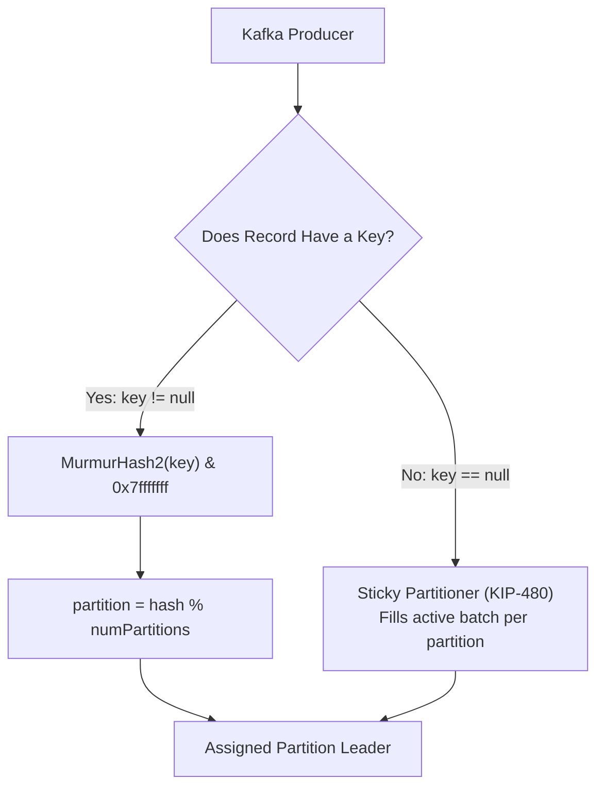
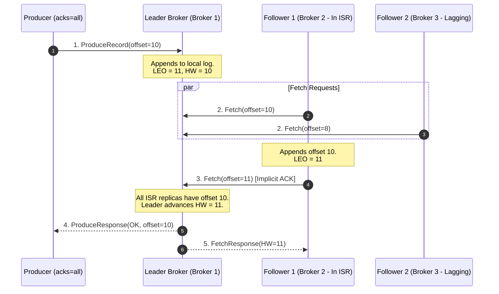
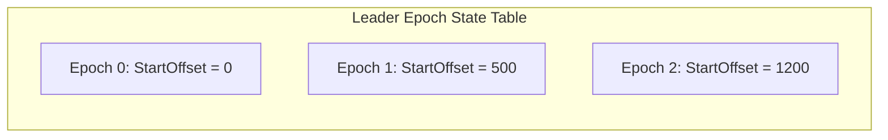

---
**Course:** Enterprise Real-Time Data Engineering  
**Instructor:** Mohamed Fouad Fakhruldeen ([Fakhr.me](https://fakhr.me))  
**Course Portal:** [fakhr.me/KafkaSpark](https://fakhr.me/KafkaSpark)  
**Code & Labs Repository:** [github.com/fakhruldeen/KafkaSpark](https://github.com/fakhruldeen/KafkaSpark)  
---

# Session S02: Student Comprehensive Handbook & Technical Textbook
## Topics, Partitions, Replication & Cluster Topology
### Scalability, Partitioning Mechanics & High-Availability Engineering

---

## 1. Executive Summary & Learning Objectives
In enterprise event-driven architectures, throughput and durability cannot be achieved through a single monolithic log. Apache Kafka achieves linear horizontal scalability by dividing topics into independent **Partitions**, and guarantees zero data loss through distributed **Replication**.

In this module, you will master:
1. **Partitioning Mechanics & Key Hashing:** The `MurmurHash2` algorithm, key-to-partition routing, and the Sticky Partitioner protocol.
2. **Replication Protocol & Consensus:** Leader vs Follower broker roles, High Watermark (HW), Log End Offset (LEO), and In-Sync Replicas (ISR).
3. **Cluster High Availability & Durability Configurations:** `min.insync.replicas`, `unclean.leader.election.enable`, and `Leader Epoch` tracking.
4. **Physical Disk & Partition Directory Layout:** Partition folders, segment rollover, and epoch checkpoint persistence.

---

## 2. Partitioning Mathematics & Record Distribution

A Kafka **Topic** is a logical category to which events are published. A **Partition** is the physical unit of scalability, parallelism, and total order.



### 2.1 The MurmurHash2 Partitioning Algorithm
When a producer publishes a record with a non-null key, the default partitioner computes the destination partition via:
$$\text{Partition} = (\text{toPositive}(\text{MurmurHash2}(\text{key})) \pmod{\text{numPartitions}})$$
where $\text{toPositive}(x) = x \ \& \ \text{0x7fffffff}$.

**Architectural Invariant:** Two records with identical binary keys published to a topic with unchanged partition count are guaranteed to land on the exact same partition, preserving strict chronological ordering.

### Worked Numeric Walkthrough: Key Hashing
Suppose `orders.events` has $N = 3$ partitions.
1. Record A: `key = "CUST-101"` $\rightarrow \text{MurmurHash2}("CUST-101") = 1,489,204,115$.
   $$\text{Partition} = 1,489,204,115 \pmod{3} = 1$$
2. Record B: `key = "CUST-102"` $\rightarrow \text{MurmurHash2}("CUST-102") = 2,048,510,992$.
   $$\text{Partition} = 2,048,510,992 \pmod{3} = 2$$
3. Record C: `key = "CUST-101"` $\rightarrow \text{Partition} = 1,489,204,115 \pmod{3} = 1$.

Record A and Record C are guaranteed to land in Partition 1 in strict temporal sequence.

---

## 3. Distributed Replication Mechanics: ISR and High Watermark

Every partition has one designated **Leader** replica and zero or more **Follower** replicas. All producer writes and consumer reads route strictly through the Leader (unless follower-fetching is explicitly enabled).



### 3.1 Key Metrics: LEO vs High Watermark
- **Log End Offset (LEO):** The offset of the next record to be written in a replica's log.
- **High Watermark (HW):** The highest offset that has been successfully replicated across *all* active replicas in the In-Sync Replicas (ISR) set:
  $$\text{HW} = \min_{r \in \text{ISR}} (\text{LEO}_r)$$
- **Consumer Isolation Guarantee:** Kafka consumers are never permitted to read past the High Watermark ($\text{Offset} < \text{HW}$). This prevents dirty reads of uncommitted records if the leader crashes.

### 3.2 In-Sync Replicas (ISR) Lifecycle
A follower is maintained in the ISR set if it sends a fetch request within `replica.lag.time.max.ms` (default $30,000\text{ ms}$). If a follower slows down or network partitions occur, the leader removes it from ISR and reports an alert metric `UnderReplicatedPartitions > 0`.

---

## 4. Leader Epoch Mechanics & Log Truncation Recovery

Prior to Kafka 0.11, follower recovery after a crash relied purely on truncating the log to the High Watermark, which under rare race conditions could lead to silent data loss or divergent logs.

Under modern Kafka, brokers record a **`leader-epoch-checkpoint`** file containing `(Epoch, StartOffset)` tuples.



When a recovered follower broker restarts:
1. It queries the active leader for the leader's Log End Offset (LEO) corresponding to the follower's latest epoch.
2. The follower truncates only the uncommitted records past that epoch boundary rather than arbitrarily rolling back past valid committed data.

### 4.2 KRaft Quorum Controller & Partition Leadership
Under modern Apache Kafka, partition leadership assignment and failover are coordinated exclusively by the **KRaft** (Kafka Raft) metadata quorum. When a partition leader broker crashes, the active KRaft controller detects the heartbeat loss and elects the next in-sync replica from the ISR set in under 250 milliseconds.

---

## 5. Enterprise Durability Configuration Matrix

To guarantee zero data loss in mission-critical retail pipelines, three configuration properties must be tuned harmoniously:

| Configuration | Recommended Value | Risk if Misconfigured |
|---|---|---|
| `replication.factor` | $3$ | If set to $1$, a single disk failure causes permanent data loss. |
| `min.insync.replicas` | $2$ | If set to $1$, the broker acknowledges writes even if all followers are dead, risking data loss on subsequent leader crash. |
| `acks` (Producer) | `all` (or `-1`) | If set to `1` or `0`, producer receives success before followers replicate, risking lost committed data. |
| `unclean.leader.election.enable` | `false` | If set to `true`, an out-of-sync replica can be elected leader, destroying all committed records it missed. |

---

## 6. Enterprise Production Troubleshooting Scenarios

### Scenario 1: `NOT_ENOUGH_REPLICAS_EXCEPTION` on High Load
- **Symptom:** Producer throws `org.apache.kafka.common.errors.NotEnoughReplicasException`.
- **Root Cause:** Topic configured with `replication.factor=3` and `min.insync.replicas=2`. Two brokers crashed or experienced network isolation, leaving only 1 broker in ISR. Because $1 < 2$, the leader rejects writes.
- **Diagnosis:**
  ```bash
  kafka-topics.sh --bootstrap-server kafka1:9092 --describe --under-replicated-partitions
  ```
- **Remediation:** Investigate why followers fell out of ISR (network saturation, GC pauses) and restore broker health.

---

## 7. Formal Technical Glossary & System Invariants

| Term | Formal Engineering Definition | Architectural Invariant |
|---|---|---|
| **MurmurHash2** | Non-cryptographic 32-bit hash function providing uniform distribution and low collision rates. | Maps keys deterministically to partitions. |
| **High Watermark** | The offset up to which all replicas in the ISR have written the message. | Defines the boundary of committed, readable data for consumers. |
| **ISR (In-Sync Replicas)** | The subset of partition replicas that are actively caught up with the partition leader. | Must have size $\ge \text{min.insync.replicas}$ for writes to succeed when `acks=all`. |
| **Leader Epoch** | Monotonically increasing 32-bit integer incremented every time a new partition leader is elected. | Replaces HW truncation during recovery, eliminating phantom log divergence. |

---

## 8. Canonical Documentation & Industry Certification Roadmap

### Canonical Documentation Links
- [Apache Kafka Official Documentation: Replication Protocol](https://kafka.apache.org/documentation/#replication)
- [KIP-101: Alter Replication Protocol to Use Leader Epoch rather than High Watermark](https://cwiki.apache.org/confluence/display/KAFKA/KIP-101)
- [Confluent Documentation: Hands-on Replication Topologies](https://docs.confluent.io/platform/current/kafka/architecture.html)

### Certification Objectives Alignment (Confluent CCDAK)
- **Domain 1: Topic Architecture:** Partition counts, key hashing, replication factor sizing.
- **Domain 2: High Availability:** High Watermark semantics, ISR shrink/expand alerts, min.insync.replicas.
- **Domain 3: Failure Recovery:** Unclean leader election, Leader Epoch checkpoint reconciliation.
