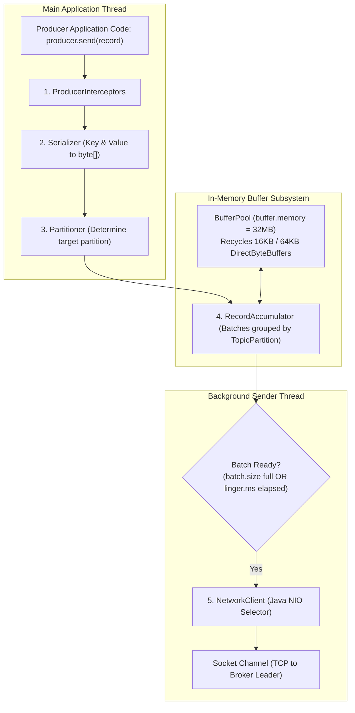
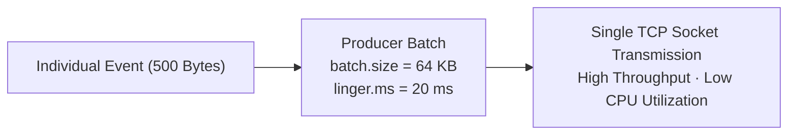
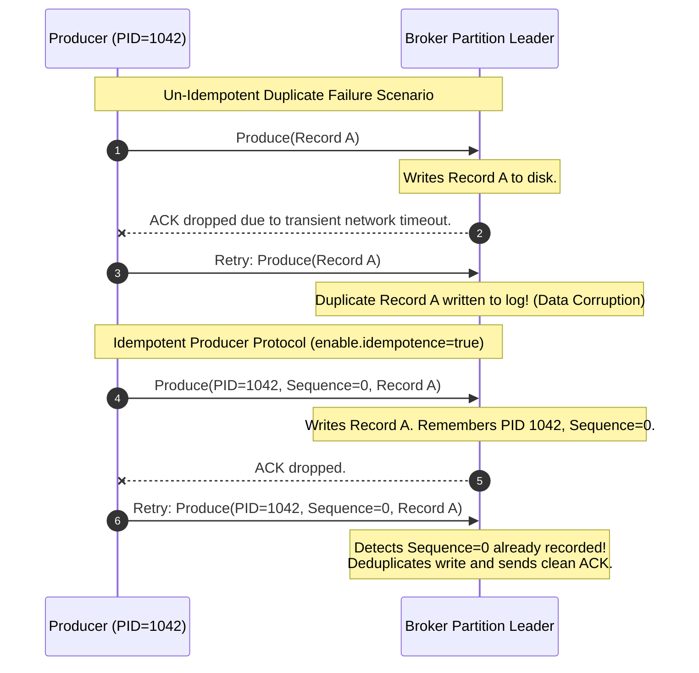

---
**Course:** Enterprise Real-Time Data Engineering  
**Instructor:** Mohamed Fouad Fakhruldeen ([Fakhr.me](https://fakhr.me))  
**Course Portal:** [fakhr.me/KafkaSpark](https://fakhr.me/KafkaSpark)  
**Code & Labs Repository:** [github.com/fakhruldeen/KafkaSpark](https://github.com/fakhruldeen/KafkaSpark)  
---

# Session S03: Student Comprehensive Handbook & Technical Textbook
## Kafka Producer Internals, Batching & Delivery Semantics
### High-Throughput Ingestion, Idempotence & Exactly-Once Semantics

---

## 1. Executive Summary & Learning Objectives
The Apache Kafka Producer is not a simple network socket wrapper. It is an asynchronous, dual-threaded, highly optimized batching engine capable of multiplexing millions of events per second onto distributed brokers.

In this module, you will master:
1. **Producer Architecture:** Main application thread vs background `Sender` I/O thread, `RecordAccumulator`, and `BufferPool` memory allocation.
2. **Batching Dynamics & Latency Optimization:** `batch.size` vs `linger.ms` trade-offs and adaptive throughput tuning.
3. **End-to-End Wire Compression:** Comparing `none`, `snappy`, `lz4`, `gzip`, and `zstd` across network and broker storage boundaries.
4. **Delivery Semantics & Idempotent Publishing:** Sequence numbers, Producer ID (PID), `max.in.flight.requests.per.connection = 5`, and exactly-once transactional boundaries.

---

## 2. Producer Internal Dual-Threaded Architecture

The Kafka Producer separates client-side record creation from network transmission through two asynchronously decoupled threads:

### 2.1 The RecordAccumulator and BufferPool
- When `send()` is invoked, the record is serialized and assigned a partition.
- It is appended to a `ProducerBatch` inside the **`RecordAccumulator`**.
- Instead of allocating new byte arrays on every message (which would trigger JVM Garbage Collector thrashing), the producer allocates memory blocks from a pre-allocated pool called the **`BufferPool`** (default `buffer.memory = 33554432` bytes, i.e., $32\text{ MB}$).
- Once a batch is sent and acknowledged, its memory block is returned to the pool for immediate reuse.

---

## 3. High-Throughput Batching: `batch.size` vs `linger.ms`

Network efficiency depends on amortizing TCP header overhead ($54\text{ bytes}$ per packet) across thousands of payload bytes:

$$\text{Effective Throughput} \propto \frac{\text{Batch Payload Bytes}}{\text{TCP Overhead} + \text{Broker System Call Latency}}$$

- **`batch.size` (bytes):** The maximum physical byte capacity of a single batch (default $16\text{ KB}$, recommended $64\text{ KB}$ to $128\text{ KB}$ for high-throughput retail ingestion).
- **`linger.ms` (milliseconds):** The maximum artificial delay the producer thread will wait to allow additional records to fill the batch before sending.
  - If `linger.ms = 0`, the batch is dispatched immediately as soon as a network thread is free (minimal latency, low throughput).
  - If `linger.ms = 20`, the producer pauses up to $20\text{ ms}$, aggregating records into dense batches (yielding $5\times$ to $10\times$ higher throughput with negligible perceived delay).

---

## 4. End-to-End Compression: Snappy, LZ4, Zstandard

Kafka compresses data on the client side at the **batch level** rather than per record. This provides dramatic algorithmic advantages because compression dictionaries discover repeated JSON keys and schemas across hundreds of records in the same batch.

| Codec | Compression Ratio | CPU Overhead (Produce) | Decompression Speed | Best Enterprise Use Case |
|---|---|---|---|---|
| **Snappy** | Moderate ($\sim 50\%$) | Ultra-low | High | Real-time low-latency event streaming (Default choice). |
| **LZ4** | Moderate ($\sim 50\%$) | Ultra-low | Extremely fast | Ultra-high throughput log aggregation. |
| **zstd** | Very high ($\sim 70\%$) | Tunable | Very fast | Enterprise retail archive, cross-region replication. |
| **gzip** | Highest | Heavy | Slow | Cold storage archival (Rarely used in streaming). |

**Zero Broker Decompression:** The Kafka broker writes the compressed batch directly to disk without decompressing it, preserving CPU cycles and storage capacity end-to-end.

---

## 5. Delivery Guarantees & The Idempotent Producer

In distributed systems, network packets can be lost, delayed, or duplicated:

### 5.1 Mechanical Operation of Idempotence
When `enable.idempotence = true` (default in Kafka $3.0+$):
1. **Producer ID (PID):** The broker assigns a 64-bit unique PID to each producer instance during initialization.
2. **Sequence Numbers:** The producer assigns a strictly monotonic sequence number ($0, 1, 2, \dots$) to every batch for each target partition.
3. **Broker Deduplication Window:** The broker maintains a sliding window of the last 5 committed sequence numbers per PID.
   - If a batch arrives with $\text{Sequence} \le \text{Expected Sequence}$, the broker discards the duplicate payload and returns an ACK.
   - If $\text{Sequence} > \text{Expected Sequence} + 1$, an out-of-order exception is raised.

**Strict Invariant:** To maintain order while enabling pipelined in-flight requests, Kafka requires:
$$\text{max.in.flight.requests.per.connection} \le 5$$

---

## 6. Enterprise Production Troubleshooting Scenarios

### Scenario 1: `OutOfOrderSequenceException` on Retries
- **Symptom:** Producer logs `org.apache.kafka.common.errors.OutOfOrderSequenceException`.
- **Root Cause:** A producer had `enable.idempotence=true` but `max.in.flight.requests.per.connection` was manually set $> 5$, or multiple producer instances attempted to reuse the same transactional ID.
- **Remediation:** Keep `max.in.flight.requests.per.connection = 5` and ensure distinct transactional IDs per active producer instance.

### Scenario 2: Buffer Pool Exhaustion under Downstream Lag
- **Symptom:** `org.apache.kafka.common.errors.TimeoutException: Failed to allocate memory within the configured max blocking time 60000 ms`.
- **Root Cause:** Producers are generating records faster than brokers can acknowledge them, exhausting the $32\text{ MB}$ `buffer.memory`.
- **Remediation:** Enable Snappy compression, scale partitions, or tune `max.block.ms` and backpressure.

---

## 7. Formal Technical Glossary & System Invariants

| Term | Formal Engineering Definition | Architectural Invariant |
|---|---|---|
| **RecordAccumulator** | In-memory client buffer storing un-sent records partitioned by topic-partition. | Decouples caller thread from network socket I/O. |
| **Idempotence** | Mathematical property $f(f(x)) = f(x)$ ensuring retried writes produce exactly one state modification. | Eliminates duplicate records on network ACK timeouts. |
| **max.in.flight.requests.per.connection** | Number of unacknowledged network requests the client sends before blocking. | Must be $\le 5$ with idempotence to guarantee strict partition ordering. |
| **Snappy** | Fast byte-oriented compression library developed by Google. | Delivers optimal balance between CPU utilization and compression ratio. |

---

## 8. Canonical Documentation & Industry Certification Roadmap

### Canonical Documentation Links
- [Apache Kafka Producer Configurations Reference](https://kafka.apache.org/documentation/#producerconfigs)
- [KIP-98: Exactly Once Delivery and Transactional Messaging](https://cwiki.apache.org/confluence/display/KAFKA/KIP-98)
- [Google Snappy Compression Architecture](https://github.com/google/snappy)

### Certification Objectives Alignment (Confluent CCDAK)
- **Domain 1: Producer Mechanics:** Buffer memory sizing, batch size vs linger trade-offs.
- **Domain 2: Delivery Guarantees:** acks=all, idempotence sequence numbers, retry policies.
- **Domain 3: Error Handling:** Retriable vs fatal exceptions, custom partitioner routing.
