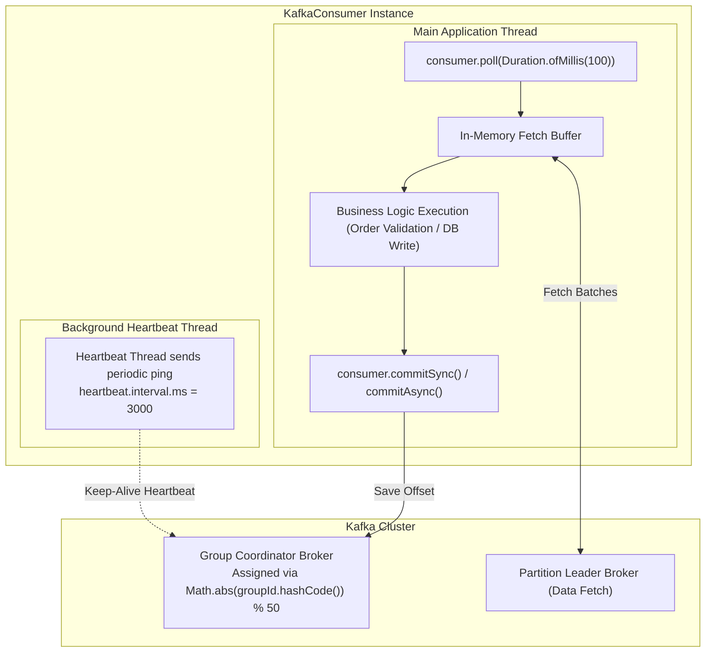
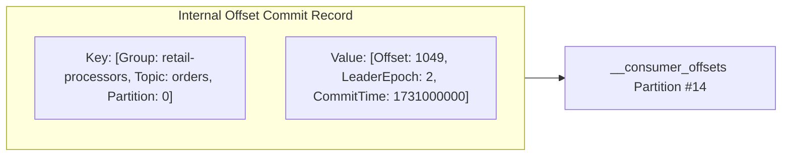
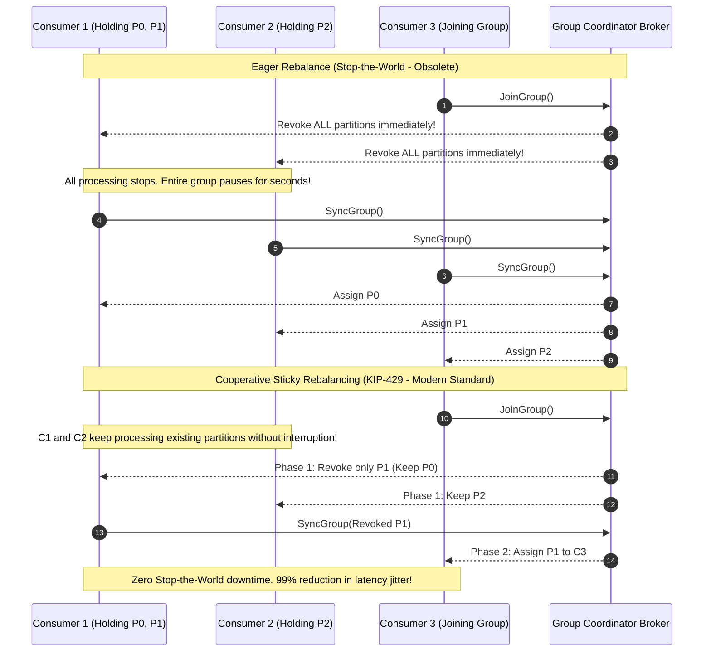

---
**Course:** Enterprise Real-Time Data Engineering  
**Instructor:** Mohamed Fouad Fakhruldeen ([Fakhr.me](https://fakhr.me))  
**Course Portal:** [fakhr.me/KafkaSpark](https://fakhr.me/KafkaSpark)  
**Code & Labs Repository:** [github.com/fakhruldeen/KafkaSpark](https://github.com/fakhruldeen/KafkaSpark)  
---

# Session S04: Student Comprehensive Handbook & Technical Textbook
## Consumer Group Internals, Offsets & Cooperative Rebalancing
### Scalable Consumption, Group Coordination & High-Reliability Processing

---

## 1. Executive Summary & Learning Objectives
Kafka consumers do not operate as isolated listeners. They collaborate in coordinated **Consumer Groups** to divide partition workloads dynamically. When consumers join, fail, or crash, the cluster rebalances partition ownership automatically.

In this module, you will master:
1. **The Polling Loop & Consumer Architecture:** Single-threaded execution model, `poll()`, and background heartbeat threads.
2. **Offset Commit Management:** Commit storage in internal topic `__consumer_offsets`, at-least-once vs at-most-once vs exactly-once semantics.
3. **Consumer Rebalance Protocols:** The historical Eager (Stop-the-World) protocol vs modern **Cooperative Sticky Rebalancing** (KIP-429).
4. **Heartbeat Timers & Failure Detection:** `session.timeout.ms`, `heartbeat.interval.ms`, and `max.poll.interval.ms`.

---

## 2. Consumer Architecture: The Polling Loop & Heartbeat Thread

Unlike traditional message queues where a background broker thread pushes messages over open sockets, Apache Kafka uses a **pull-based** consumer model.

### 2.1 The Two Timeout Clocks
Kafka consumers decouple consumer health detection from business processing duration via two distinct timers:
1. **Liveness Clock (`session.timeout.ms = 45000`, `heartbeat.interval.ms = 3000`):**
   - Managed automatically by the background heartbeat thread.
   - If the consumer process crashes or suffers network disconnection, heartbeats cease. After $45\text{ seconds}$, the coordinator triggers a rebalance.
2. **Progress Clock (`max.poll.interval.ms = 300000`):**
   - Managed by the application thread calling `poll()`.
   - If processing a batch of records blocks longer than $5\text{ minutes}$ (e.g. frozen downstream database), the consumer is deemed dead and evicted from the group, preventing unconsumed partition stalling.

---

## 3. Offset Commit Storage: `__consumer_offsets`

Kafka consumers persist their reading progress by committing offsets to an internal, highly compacted Kafka topic named **`__consumer_offsets`** (configured with $50$ partitions and `cleanup.policy = compact`).

$$\text{Group Coordinator Partition} = \text{Math.abs}(\text{groupId.hashCode()}) \pmod{50}$$

### 3.1 Offset Commit Semantics: At-Least-Once vs At-Most-Once
- **At-Most-Once:** Offsets are committed *before* processing records. If the consumer crashes during processing, un-processed records are lost forever.
- **At-Least-Once (Default Enterprise Standard):** Offsets are committed *after* records are successfully processed and written downstream. If a crash occurs, duplicate records may be re-read upon restart (requiring downstream idempotent deduplication).

---

## 4. Rebalance Protocols: Eager vs Cooperative Sticky

When a consumer joins or leaves a group, partitions must be redistributed across active group members.

### 4.2 Poison Pill Quarantine: Dead Letter Topic (DLT)
When a consumer encounters an unparseable or malformed event payload, crashing the processing thread halts partition consumption. In enterprise production, consumers catch deserialization exceptions and route the corrupt payload to a **Dead Letter Topic (DLT)**, allowing the consumer group to commit the offset and maintain continuous streaming.

Under **Cooperative Sticky Rebalancing** (`partition.assignment.strategy = org.apache.kafka.clients.consumer.CooperativeStickyAssignor`):
- Unaffected consumers continue reading and processing data throughout the rebalance.
- Partitions are migrated in a seamless two-phase handshake, eliminating consumer lag spikes during deployments.

---

## 5. Enterprise Production Troubleshooting Scenarios

### Scenario 1: The Cascading Rebalance Storm
- **Symptom:** Consumer group repeatedly rebalances every few minutes; CPU spikes, throughput drops to zero.
- **Root Cause:** A heavy processing step takes $350\text{ seconds}$ per batch, exceeding `max.poll.interval.ms = 300000`. The coordinator evicts the consumer, assigning its partitions to another consumer, which also times out, triggering an infinite rebalance loop.
- **Remediation:** Reduce batch size via `max.poll.records = 100` or increase `max.poll.interval.ms`.

---

## 6. Formal Technical Glossary & System Invariants

| Term | Formal Engineering Definition | Architectural Invariant |
|---|---|---|
| **__consumer_offsets** | Internal Kafka compacted topic storing committed consumer offsets. | Primary source of truth for consumer position across group restarts. |
| **Heartbeat** | Periodic ping sent by consumer background thread to prove liveness. | Keeps consumer registered in group without depending on poll loop. |
| **Cooperative Sticky** | Non-disruptive partition assignor performing incremental two-phase reassignments. | Eliminates stop-the-world pauses for unaffected group members. |
| **max.poll.interval.ms** | Maximum time allowed between poll() calls before consumer is marked dead. | Prevents silent deadlock or thread stalling in worker code. |
| **Consumer Lag** | Difference between partition Log End Offset and consumer group committed offset. | Indicates downstream processing delay or consumer capacity exhaustion. |

---

## 7. Canonical Documentation & Industry Certification Roadmap

### Canonical Documentation Links
- [Apache Kafka Consumer Configurations Reference](https://kafka.apache.org/documentation/#consumerconfigs)
- [KIP-429: Incremental Cooperative Rebalancing Protocol](https://cwiki.apache.org/confluence/display/KAFKA/KIP-429)
- [Confluent Consumer Rebalance Guide](https://docs.confluent.io/platform/current/clients/consumer.html)

### Certification Objectives Alignment (Confluent CCDAK)
- **Domain 1: Consumer Groups:** Partition assignment, group coordinator discovery.
- **Domain 2: Offset Management:** commitSync vs commitAsync, lag monitoring.
- **Domain 3: Rebalance Optimization:** CooperativeStickyAssignor configuration, timer tuning.
