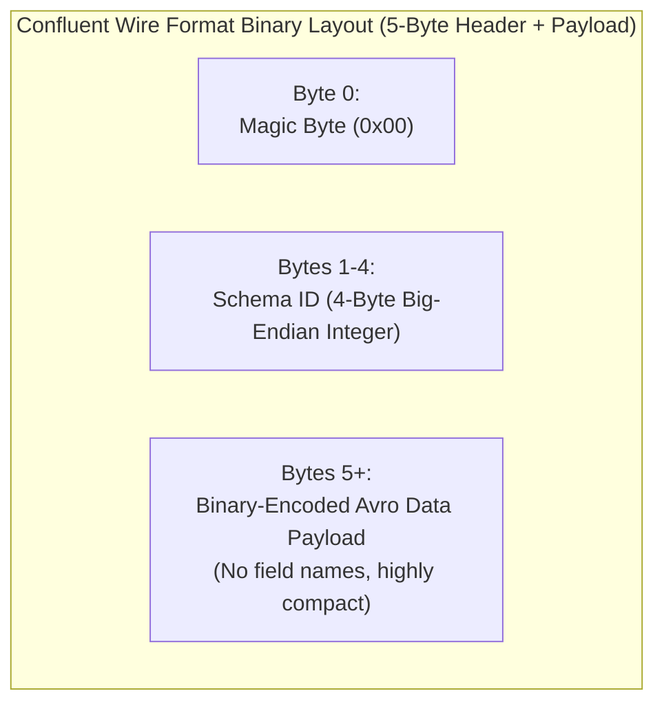
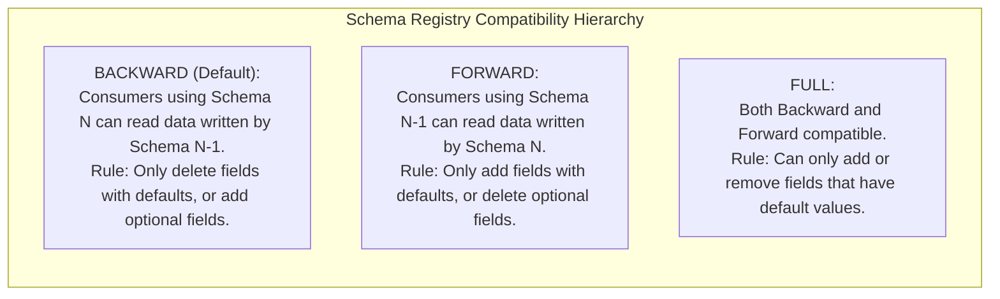

---
**Course:** Enterprise Real-Time Data Engineering  
**Instructor:** Mohamed Fouad Fakhruldeen ([Fakhr.me](https://fakhr.me))  
**Course Portal:** [fakhr.me/KafkaSpark](https://fakhr.me/KafkaSpark)  
**Code & Labs Repository:** [github.com/fakhruldeen/KafkaSpark](https://github.com/fakhruldeen/KafkaSpark)  
---

# Session S05: Student Comprehensive Handbook & Technical Textbook
## Confluent Schema Registry, Apache Avro & Data Contracts
### Schema Evolution, Wire Format Internals & Governance

---

## 1. Executive Summary & Learning Objectives
In enterprise event-driven architectures, Kafka topics carry raw byte payloads without schema validation. If a service publishes an unexpected data structure, downstream consumers crash—a failure known as a **poison pill**. The **Confluent Schema Registry** establishes strict **Data Contracts** to govern event structures and evolution across distributed systems.

In this module, you will master:
1. **Schema Registry Architecture:** Distributed schema storage in internal topic `_schemas`, local client caching, and REST APIs.
2. **The Confluent Wire Format Binary Specification:** Magic Byte `0x00`, 4-byte Schema ID, and binary Avro serialization.
3. **Apache Avro Schema Definitions:** Primitive vs complex types, optional fields with `null` unions, and logical types (timestamps, decimals).
4. **Schema Evolution & Compatibility Modes:** `BACKWARD`, `FORWARD`, `FULL`, and transitives, preventing breaking changes (`HTTP 409 Conflict`).

---

## 2. Confluent Wire Format Binary Specification

Kafka messages serialized with Confluent Schema Registry do not embed the entire JSON schema in every message (which would cause massive bandwidth overhead). Instead, they prepended a **5-byte header**:



### 2.1 The Wire Format Byte Layout
1. **Byte 0 (Magic Byte):** Always `0x00`. Indicates to consumers that this message conforms to the Confluent Schema Registry wire format.
2. **Bytes 1–4 (Schema ID):** A 32-bit big-endian integer representing the unique schema ID registered in Schema Registry.
3. **Bytes 5+ (Payload):** Pure binary Avro data encoded using zigzag integer encoding and variable-length byte arrays.

### Worked Numeric Walkthrough: Binary Packet Inspection
Suppose an order event is serialized with registered `Schema ID = 42`.
- Magic byte: `0x00`
- Schema ID 42 in 32-bit hex: `0x00 0x00 0x00 0x2A`
- Combined 5-byte prefix: `[00 00 00 00 2A]`
When a consumer reads the message:
1. It reads the first 5 bytes.
2. It extracts Schema ID `42`.
3. It checks its local cache (`ConcurrentHashMap<Integer, Schema>`). If absent, it queries Schema Registry via HTTP `GET /schemas/ids/42`, caches it, and deserializes the remaining bytes.

---

## 3. Schema Evolution & Compatibility Rules

As business requirements change, schemas must evolve without breaking existing consumers.



| Compatibility Mode | What it Guarantees | Allowed Evolution Actions |
|---|---|---|
| **BACKWARD** (Default) | New consumer reads old producer records. | Add optional fields with default values; delete fields that had defaults. |
| **FORWARD** | Old consumer reads new producer records. | Add new fields; delete optional fields. |
| **FULL** | Bidirectional compatibility. | Only add or delete fields that have explicit default values. |
| **NONE** | No compatibility checks enforced. | Free modification (High production risk). |

### 3.1 Breaking Contract Defense (`HTTP 409 Conflict`)
If a developer attempts to register an incompatible schema (e.g. adding a required field without a default value in `BACKWARD` mode):
```bash
curl -X POST -H "Content-Type: application/vnd.schemaregistry.v1+json" \
  --data '{"schema": "..."}' http://localhost:8081/subjects/retail.orders-value/versions
```
Schema Registry rejects the update with **`HTTP 409 Conflict`**:
```json
{"error_code": 409, "message": "Schema being registered is incompatible with an earlier schema for subject \"retail.orders-value\""}
```

---

## 4. Enterprise Production Troubleshooting Scenarios

### Scenario 1: `SerializationException: Unknown Magic Byte`
- **Symptom:** Consumer fails with `org.apache.kafka.common.errors.SerializationException: Unknown magic byte!`.
- **Root Cause:** A raw JSON or plain-text string producer published data to a topic expecting Avro, causing the consumer to read an unexpected first byte (e.g. `{` = `0x7B` instead of `0x00`).
- **Remediation:** Inspect the topic with a raw console consumer, quarantine corrupt records, and enforce Schema Registry serializers on all producers.

---

## 5. Formal Technical Glossary & System Invariants

| Term | Formal Engineering Definition | Architectural Invariant |
|---|---|---|
| **Magic Byte** | The single initial byte `0x00` in Confluent wire format. | Distinguishes Schema Registry payloads from raw binary streams. |
| **Schema ID** | 32-bit unique identifier referencing a specific schema version in Schema Registry. | Enables schema lookup with zero schema definition overhead in messages. |
| **BACKWARD** | Compatibility mode guaranteeing newer consumers can parse records written by older producers. | Enables consumer upgrades before producer upgrades. |
| **409 Conflict** | HTTP status code returned by Schema Registry when a schema breaks compatibility. | Prevents corrupting topics with incompatible data contracts. |
| **Avro** | Row-oriented binary serialization framework with rich JSON-based schemas. | Provides compact, high-speed binary serialization with full schema evolution. |

---

## 6. Canonical Documentation & Industry Certification Roadmap

### Canonical Documentation Links
- [Confluent Schema Registry Overview & Architecture](https://docs.confluent.io/platform/current/schema-registry/index.html)
- [Confluent Wire Format Specification](https://docs.confluent.io/platform/current/schema-registry/fundamentals/serdes-develop/index.html#wire-format)
- [Apache Avro Official Specification 1.11+](https://avro.apache.org/docs/current/spec.html)

### Certification Objectives Alignment (Confluent CCDAK)
- **Domain 1: Data Contracts:** Avro schemas, JSON Schema, Protobuf support.
- **Domain 2: Wire Format:** Magic byte structure, schema ID caching.
- **Domain 3: Governance:** Compatibility modes, subject naming strategies (`TopicNameStrategy`).
