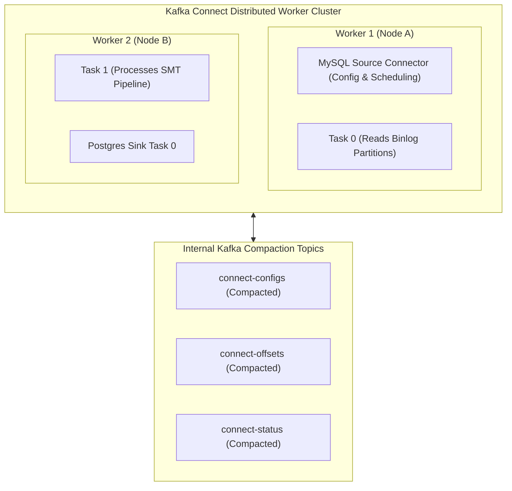
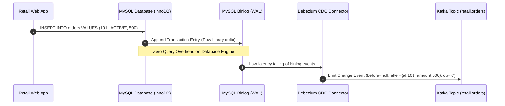
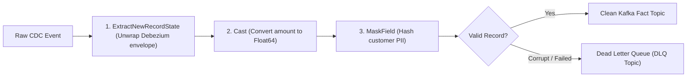

---
**Course:** Enterprise Real-Time Data Engineering  
**Instructor:** Mohamed Fouad Fakhruldeen ([Fakhr.me](https://fakhr.me))  
**Course Portal:** [fakhr.me/KafkaSpark](https://fakhr.me/KafkaSpark)  
**Code & Labs Repository:** [github.com/fakhruldeen/KafkaSpark](https://github.com/fakhruldeen/KafkaSpark)  
---

# Session S06: Student Comprehensive Handbook & Technical Textbook
## Kafka Connect, Enterprise CDC & Data Integration
### Change Data Capture, SMT Pipelines & Fault-Tolerant Ingestion

---

## 1. Executive Summary & Learning Objectives
Enterprise architectures require bi-directional data flow between Kafka and legacy operational data stores (RDBMS, NoSQL, data warehouses). **Kafka Connect** provides a distributed, scalable runtime for connecting external systems to Kafka without writing custom polling code. Combined with **Change Data Capture (CDC)** engines like Debezium, it turns transactional databases into real-time event streams.

In this module, you will master:
1. **Kafka Connect Distributed Architecture:** Workers, Connectors, Tasks, and internal consensus topics.
2. **Change Data Capture (CDC) Mechanics:** Reading database Transaction Write-Ahead Logs (MySQL binlog / PostgreSQL WAL).
3. **Single Message Transforms (SMT):** Lightweight in-flight schema and value mutations.
4. **Resilient Error Handling:** `errors.tolerance = all`, Dead Letter Queues (`errors.deadletterqueue.topic.name`), and context headers.

---

## 2. Kafka Connect Distributed Worker Architecture

Kafka Connect operates as an independent distributed cluster of **Distributed Workers** coordinated via Kafka's group management protocol.



### 2.1 Connectors vs Tasks
- **Connector:** Defines configuration, credentials, and splits large workloads into independent execution units called **Tasks**.
- **Task:** Stateless execution worker threads that perform the physical I/O (reading from source or writing to sink).
- If a worker crashes, the remaining workers trigger a rebalance and reassign active tasks within seconds.

---

## 3. Enterprise Change Data Capture (CDC) with Debezium

Traditional batch extraction (running `SELECT * FROM orders WHERE updated_at > last_sync`) creates heavy query load on production databases and misses deleted or rapidly overwritten records.

**Debezium CDC** tails the database's internal transaction log (WAL):



- **Guarantees:** Captures every single `INSERT`, `UPDATE`, and `DELETE` with sub-second latency.
- **Zero Query Impact:** Does not execute SQL queries against active tables; reads raw append-only binary logs directly.

---

## 4. Single Message Transforms (SMT) and Dead Letter Queues (DLQ)

Before messages are published to Kafka (or before sink tasks write them downstream), Kafka Connect allows chaining lightweight transformations called **Single Message Transforms (SMT)**:



### 4.1 Dead Letter Queue (DLQ) Pattern
By default, an unhandled serialization error halts the entire connector task. In production, we configure:
```properties
errors.tolerance=all
errors.deadletterqueue.topic.name=orders.dlq
errors.deadletterqueue.context.headers.enable=true
```
Failed records are diverted to the DLQ with error stacks embedded in headers, ensuring $100\%$ pipeline availability.

---

## 5. Enterprise Production Troubleshooting Scenarios

### Scenario 1: Connector Task Fails with `SchemaParseException`
- **Symptom:** Kafka Connect REST API reports `state: FAILED` for `orders-sink-task-0`.
- **Root Cause:** A corrupt message missing expected schema metadata was encountered, and `errors.tolerance` was set to `none`.
- **Remediation:** Configure `errors.tolerance=all` and route corrupted records to a Dead Letter Topic.

---

## 6. Formal Technical Glossary & System Invariants

| Term | Formal Engineering Definition | Architectural Invariant |
|---|---|---|
| **Distributed Workers** | JVM daemon processes collaborating in a Connect cluster to run connectors and tasks. | Automatically rebalance and reassign tasks upon worker node crash. |
| **SMT (Single Message Transform)** | In-memory stream transformations executed per message inside Connect pipeline. | Lightweight modifications executed without external processing engines. |
| **Dead Letter Queue (DLQ)** | Destination topic where corrupt or unparseable messages are diverted. | Isolates poison pills without interrupting continuous data ingestion. |
| **CDC (Change Data Capture)** | Pattern of capturing database transaction changes directly from transaction logs. | Captures all historical inserts/updates/deletes with zero database query locks. |

---

## 7. Canonical Documentation & Industry Certification Roadmap

### Canonical Documentation Links
- [Apache Kafka Connect Architecture & User Guide](https://kafka.apache.org/documentation/#connect)
- [Debezium Official Architecture Documentation](https://debezium.io/documentation/reference/stable/architecture.html)
- [Confluent Kafka Connect SMT and DLQ Guide](https://docs.confluent.io/platform/current/connect/transforms/index.html)

### Certification Objectives Alignment (Confluent CCDAK)
- **Domain 1: Connect Architecture:** Distributed vs standalone modes, internal topic semantics.
- **Domain 2: Connectors & Configuration:** Source vs sink connectors, task scaling.
- **Domain 3: Fault Tolerance:** SMT chaining, Dead Letter Queue error handling.
