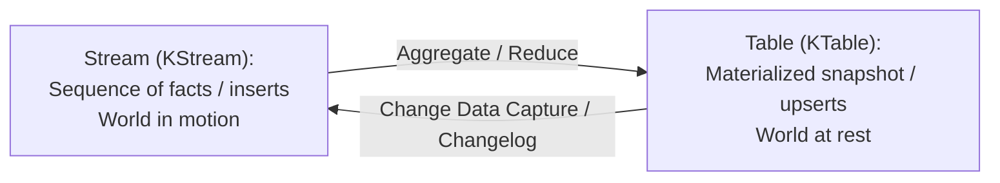
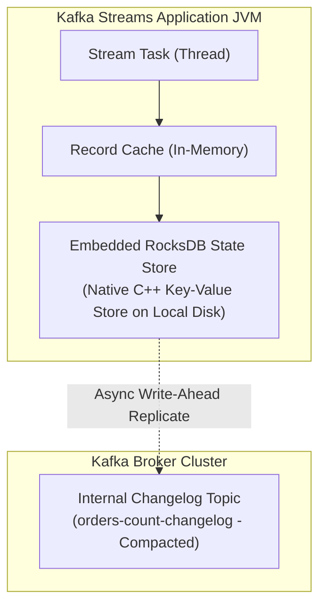
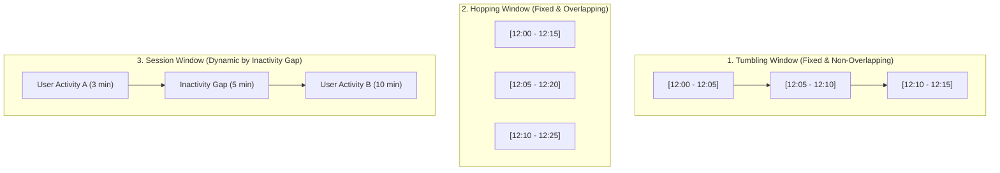

---
**Course:** Enterprise Real-Time Data Engineering  
**Instructor:** Mohamed Fouad Fakhruldeen ([Fakhr.me](https://fakhr.me))  
**Course Portal:** [fakhr.me/KafkaSpark](https://fakhr.me/KafkaSpark)  
**Code & Labs Repository:** [github.com/fakhruldeen/KafkaSpark](https://github.com/fakhruldeen/KafkaSpark)  
---

# Session S07: Student Comprehensive Handbook & Technical Textbook
## Stream Processing: Kafka Streams & ksqlDB
### The Stream-Table Duality, Stateful Processing & RocksDB Mechanics

---

## 1. Executive Summary & Learning Objectives
Stream processing transforms Kafka from a passive event bus into an active computational pipeline. With **Kafka Streams** (a client-side Java library) and **ksqlDB** (an event streaming database), engineers can perform stateful aggregations, joins, and windowed analytics with sub-second latency and zero external cluster dependencies.

In this module, you will master:
1. **The Stream-Table Duality:** Mathematical equivalence of streams and tables ($KStream \leftrightarrow KTable$).
2. **Stateful Processing & RocksDB Storage:** Embedded key-value state stores, write-ahead changelog topics, and fast recovery.
3. **Windowing Semantics:** Tumbling, Hopping, Sliding, and Session windows, with grace periods for out-of-order data.
4. **ksqlDB SQL Engine:** Compiling SQL queries into live Kafka Streams topologies, materialized views, and push/pull query patterns.

---

## 2. The Core Scientific Paradigm: Stream-Table Duality

At the heart of modern stream processing lies the **Stream-Table Duality**:



- **A Stream is a Table in Motion:** If you take a stream of change events and continuously fold/aggregate them over time, you produce a table representing current state.
- **A Table is a Stream at Rest:** If you tail the modifications of a table over time, you produce a stream of change events (the changelog).

### Worked Numeric Walkthrough: KStream to KTable Transformation
Consider order updates for customer `CUST-99` published to `orders.events`:
1. $t_1$: `(CUST-99, Status=PENDING, Amount=100)`
2. $t_2$: `(CUST-99, Status=PAID, Amount=100)`
3. $t_3$: `(CUST-99, Status=SHIPPED, Amount=100)`

- **KStream View:** Contains 3 distinct records. Iterating over the stream processes 3 facts.
- **KTable View:** Contains 1 record with key `CUST-99` and value `Status=SHIPPED`. The table applies primary key upsert semantics automatically.

---

## 3. Stateful Processing Architecture: RocksDB & Changelog Topics

Stateful stream operations (e.g. `count()`, `aggregate()`, `join()`) require storing intermediate state. Rather than storing state in remote databases (which introduces prohibitive network round-trip latency), Kafka Streams embeds **RocksDB** directly inside the application process memory.



### 3.1 Fault-Tolerance & Standby Replicas
1. Every write to the local RocksDB store is asynchronously replicated to an internal Kafka **Changelog Topic** configured with `cleanup.policy = compact`.
2. If the container or machine crashes, a replacement task spins up on a new node and replays the changelog topic to reconstruct the local RocksDB database rapidly.
3. By enabling **Standby Replicas** (`num.standby.replicas = 1`), Kafka Streams maintains warm standby state stores on other nodes, enabling instantaneous failover with zero restore lag.

---

## 4. Windowing Topologies: Tumbling vs Hopping vs Session

Event-time analytics require grouping continuous streams into discrete temporal windows:



- **Tumbling Window:** Fixed size, contiguous, non-overlapping (e.g. 5-minute sales totals). Every event belongs to exactly one window.
- **Hopping Window:** Fixed duration with a defined advance interval (e.g. 15-minute moving average advanced every 5 minutes). Events belong to multiple overlapping windows.
- **Session Window:** Dynamic duration bounded by periods of inactivity (e.g. user web browsing session closing after 30 minutes of idle time).

---

## 5. ksqlDB Architecture: Streaming SQL Engine

ksqlDB provides an ANSI SQL engine built on top of Kafka Streams:

```sql
-- Create a continuous live stream over a Kafka topic
CREATE STREAM orders_stream (
    order_id VARCHAR KEY,
    customer_id INT,
    amount DOUBLE,
    store_id VARCHAR
) WITH (
    KAFKA_TOPIC = 'orders.events.v1',
    VALUE_FORMAT = 'AVRO'
);

-- Materialize a continuous live aggregation table
CREATE TABLE store_revenue_hourly AS
SELECT 
    store_id,
    COUNT(*) AS total_orders,
    SUM(amount) AS total_revenue
FROM orders_stream
WINDOW TUMBLING (SIZE 1 HOUR)
GROUP BY store_id
EMIT CHANGES;
```

- **Push Queries (`EMIT CHANGES`):** A persistent subscriber query that continuously streams new results to the client as events arrive.
- **Pull Queries:** A point-in-time lookup that queries the materialized RocksDB state store directly via HTTP REST API without reading Kafka topics.

---

## 6. Enterprise Production Troubleshooting Scenarios

### Scenario 1: State Store Restore Timeout on Pod Rescheduling
- **Symptom:** Kubernetes restarts a Kafka Streams pod; the application blocks in `REBALANCING` state for 45 minutes downloading state.
- **Root Cause:** A large state store ($150\text{ GB}$) is being rebuilt from scratch from the changelog topic over the network.
- **Remediation:** Mount persistent SSD volumes (PVCs) for RocksDB local directories and configure `num.standby.replicas = 1`.

---

## 7. Formal Technical Glossary & System Invariants

| Term | Formal Engineering Definition | Architectural Invariant |
|---|---|---|
| **KStream** | Abstraction representing an unbounded append-only stream of independent events. | Each record represents an isolated insert fact. |
| **KTable** | Abstraction representing a changelog stream where records represent updates to primary keys. | Represents current state snapshot; consecutive records with same key overwrite previous values. |
| **RocksDB** | High-performance embeddable persistent key-value store developed by Meta. | Eliminates remote RPC network latency for stateful streaming operations. |
| **Changelog** | Internal compacted Kafka topic backing an embedded state store. | Single source of truth for state store recovery after node failure. |
| **Tumbling** | Windowing strategy where time is partitioned into fixed, non-overlapping intervals. | Every event is assigned to exactly one temporal bucket. |

---

## 8. Canonical Documentation & Industry Certification Roadmap

### Canonical Documentation Links
- [Kafka Streams Developer Guide](https://kafka.apache.org/documentation/streams/)
- [ksqlDB Official Architecture Documentation](https://docs.ksqldb.io/en/latest/reference/architecture/)
- [RocksDB Tuning Guide for Distributed Streaming](https://github.com/facebook/rocksdb/wiki/RocksDB-Tuning-Guide)

### Certification Objectives Alignment (Confluent CCDAK)
- **Domain 1: Stream Processing:** Topology construction, Stream-Table duality.
- **Domain 2: Stateful Operations:** State store recovery, changelog topics, windowing grace periods.
- **Domain 3: ksqlDB:** Streams vs tables, push vs pull queries, serialization formats.
