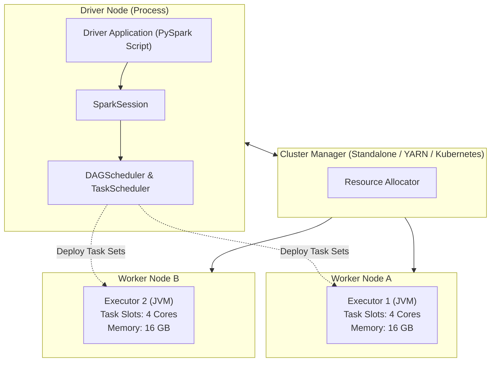
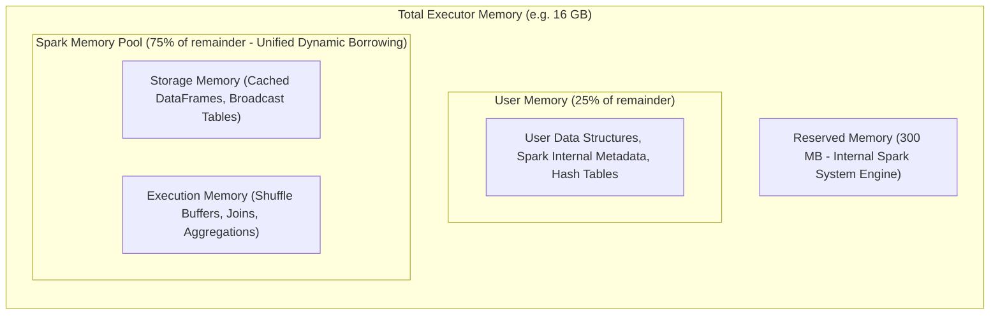
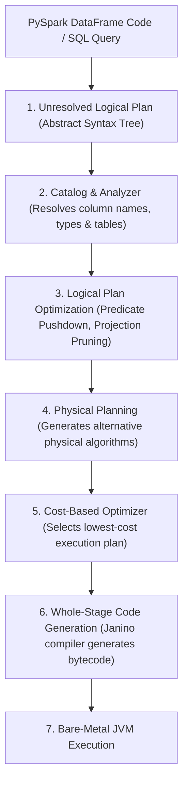
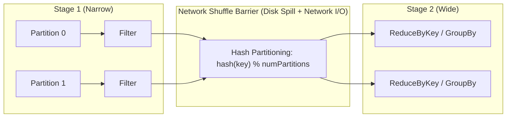

---
**Course:** Enterprise Real-Time Data Engineering  
**Instructor:** Mohamed Fouad Fakhruldeen ([Fakhr.me](https://fakhr.me))  
**Course Portal:** [fakhr.me/KafkaSpark](https://fakhr.me/KafkaSpark)  
**Code & Labs Repository:** [github.com/fakhruldeen/KafkaSpark](https://github.com/fakhruldeen/KafkaSpark)  
---

# Session S08: Student Comprehensive Handbook & Technical Textbook
## Apache Spark Core, PySpark DataFrames & Catalyst Optimization
### Distributed Computing Architecture, Memory Management & Execution Plans

---

## 1. Executive Summary & Learning Objectives
When event streaming workloads transition from low-latency event-by-event processing to massive distributed analytical processing and heavy machine learning, **Apache Spark** is the enterprise standard. Operating as a unified in-memory analytics engine, Spark coordinates thousands of worker CPU cores to process petabytes of structured and unstructured data.

In this module, you will master:
1. **Cluster Topology & Roles:** Driver process, Cluster Manager, Worker Nodes, and Executor JVMs.
2. **Unified Memory Management:** JVM Heap vs Off-Heap memory, Storage vs Execution memory borrowing.
3. **The Catalyst Optimizer Pipeline:** AST parsing, logical optimization, physical plan generation, and Whole-Stage Code Generation.
4. **PySpark Architecture:** Py4J bridge, Python Worker daemons, socket serialization, and DataFrame transformations vs actions.

---

## 2. Distributed Cluster Topology & Execution Hierarchy

Apache Spark operates on a master-worker distributed architecture:



### 2.1 The Two Fundamental Entities
- **Driver Process:** The central coordinator. It runs the user's `main()` program, constructs the `SparkSession`, translates code into a Directed Acyclic Graph (DAG) of stages, and schedules tasks onto executors.
- **Executor JVMs:** Worker processes running on cluster nodes. They execute individual data processing tasks in parallel and hold in-memory storage blocks for cached data.

---

## 3. Spark Memory Management Internals (Unified Memory Manager)

Spark allocates each executor's physical memory into distinct functional regions governed by the **Unified Memory Manager**:



### 3.1 Dynamic Memory Borrowing
- **Execution Memory:** Used for computations in shuffles, joins, sorts, and aggregations.
- **Storage Memory:** Used for caching DataFrames (`df.cache()`) and broadcasting small lookup tables.
- **The Borrowing Invariant:** Execution memory takes priority. If an execution task requires memory occupied by cached data, it evicts storage blocks to disk. Storage memory can never evict active execution buffers.

---

## 4. The Catalyst Optimizer & Project Tungsten Pipeline

The core intelligence of Spark SQL and PySpark DataFrames is the **Catalyst Optimizer**, which translates high-level functional code into optimized Java bytecode:



### 4.1 Project Tungsten Off-Heap Management
Tungsten bypasses standard Java objects to eliminate Garbage Collection overhead:
- **Binary In-Memory Layout:** Stores rows in raw off-heap binary byte arrays (avoiding Java object wrappers that turn a 4-byte integer into a 24-byte object).
- **Whole-Stage Code Generation:** Collapses chains of operators (filter, project, aggregate) into a single tight loop compiled at runtime, maximizing CPU L1/L2 cache locality.

---

## 5. Transformations vs Actions & The Shuffle Barrier

Spark operations fall into two fundamental categories:
- **Transformations (Lazy):** Define a computation recipe without executing it (`filter()`, `select()`, `groupBy()`).
  - **Narrow Transformations:** Each input partition contributes to at most one output partition (`map()`, `filter()`). Executed in parallel with zero network transfer.
  - **Wide Transformations (Shuffle):** Data from multiple input partitions must be redistributed across the network to form new output partitions (`groupBy()`, `join()`, `distinct()`).
- **Actions (Eager):** Trigger actual distributed execution and return results (`count()`, `collect()`, `write()`).



---

## 6. Enterprise Production Troubleshooting Scenarios

### Scenario 1: PySpark Serialization Bottleneck (`pickle` vs Vectorized Arrow)
- **Symptom:** Driver CPU reaches $100\%$ while executors remain idle during `df.toPandas()`.
- **Root Cause:** Standard Python-to-JVM bridging serializes data row-by-row using Python `pickle`.
- **Remediation:** Enable Apache Arrow acceleration in Spark configuration:
  ```python
  spark.conf.set("spark.sql.execution.arrow.pyspark.enabled", "true")
  ```

---

## 7. Formal Technical Glossary & System Invariants

| Term | Formal Engineering Definition | Architectural Invariant |
|---|---|---|
| **Driver** | Central JVM process coordinating Spark application lifecycle and task scheduling. | Single point of planning and orchestration for the SparkSession. |
| **Executor** | Distributed worker JVM process executing tasks and managing memory buffers. | Runs task slots in parallel; crashes do not bring down driver. |
| **Catalyst** | Extensible query optimizer performing relational algebraic tree rewrites. | Guarantees identical execution performance across Python, SQL, and Scala. |
| **Tungsten** | Spark execution engine managing off-heap binary memory and whole-stage code generation. | Eliminates Java object allocation overhead and GC pauses. |
| **Shuffle** | Redistributing data across physical cluster nodes to satisfy wide dependencies. | The most expensive operation in distributed computing; incurs disk and network I/O. |

---

## 8. Canonical Documentation & Industry Certification Roadmap

### Canonical Documentation Links
- [Apache Spark Official Architecture Overview](https://spark.apache.org/docs/latest/cluster-overview.html)
- [Databricks: Deep Dive into Catalyst Optimizer](https://www.databricks.com/blog/2015/04/13/deep-dive-into-spark-sqls-catalyst-optimizer.html)
- [PySpark Developer Reference Guide](https://spark.apache.org/docs/latest/api/python/)

### Certification Objectives Alignment (Databricks Associate Developer)
- **Domain 1: Spark Architecture:** Driver vs executor roles, cluster deployment modes.
- **Domain 2: Memory & Execution:** Memory pools, narrow vs wide transformations, shuffle partitions.
- **Domain 3: DataFrame API:** Filtering, aggregation, projection, and physical plan analysis.
