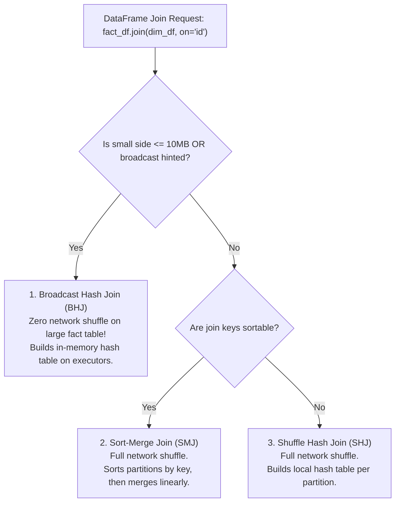
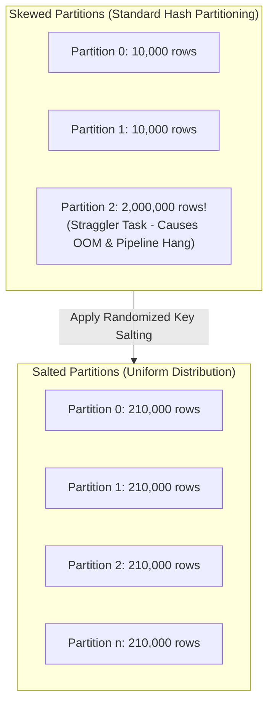
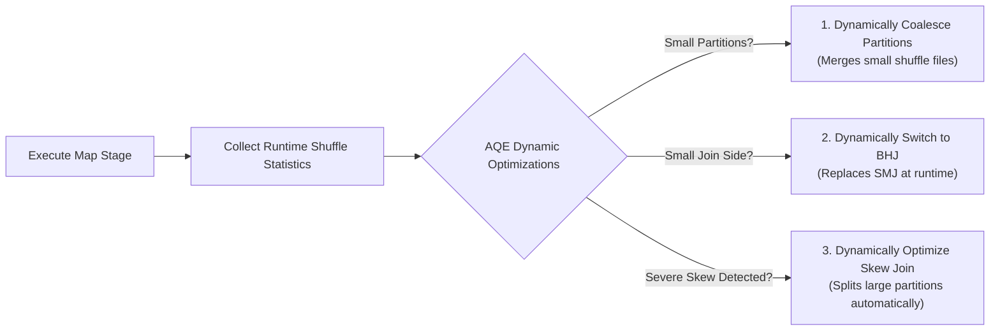

---
**Course:** Enterprise Real-Time Data Engineering  
**Instructor:** Mohamed Fouad Fakhruldeen ([Fakhr.me](https://fakhr.me))  
**Course Portal:** [fakhr.me/KafkaSpark](https://fakhr.me/KafkaSpark)  
**Code & Labs Repository:** [github.com/fakhruldeen/KafkaSpark](https://github.com/fakhruldeen/KafkaSpark)  
---

# Session S09: Student Comprehensive Handbook & Technical Textbook
## Spark SQL, Advanced Joins & Distribution Optimization
### Physical Join Selection, Shuffle Optimization & Data Skew Defense

---

## 1. Executive Summary & Learning Objectives
In enterprise data engineering, datasets rarely live in isolation. Joining high-volume transactional fact tables with reference dimension tables is the foundation of analytical feature pipelines. However, improperly structured joins trigger massive network shuffles, memory spills, and straggler tasks that can bring down distributed clusters.

In this module, you will master:
1. **Physical Join Selection Algorithms:** Broadcast Hash Join (BHJ) vs Sort-Merge Join (SMJ) vs Shuffle Hash Join (SHJ).
2. **Defensive Join Design:** Preventing join fan-out row multiplication using window function deduplication and primary key assertions.
3. **Data Skew Pathology & Key Salting Mathematics:** Uniform redistribution of pathological partition bottlenecks using randomized salt keys.
4. **Adaptive Query Execution (AQE):** Runtime coalescing of shuffle partitions, dynamic join switching, and skew join handling.

---

## 2. Physical Join Algorithms: Selection Decision Matrix

The Catalyst optimizer chooses a physical join algorithm based on dataset size, join hints, and sorting properties:



### 2.1 Broadcast Hash Join (BHJ)
- **Mechanics:** The driver collects the small dimension table into memory, serializes it into a single byte buffer, and broadcasts it to every executor via peer-to-peer BitTorrent-like transfer.
- **Performance:** Eliminates the shuffle phase on the large table entirely. The large table streams through local executor CPU cores, performing $O(1)$ in-memory hash lookups.
- **Default Threshold:** Controlled by `spark.sql.autoBroadcastJoinThreshold = 10485760` ($10\text{ MB}$). Can be forced via explicit hinting:
  ```python
  joined_df = orders_df.join(F.broadcast(customers_df), on="customer_id", how="inner")
  ```

### 2.2 Sort-Merge Join (SMJ)
- **Mechanics:** Both tables are shuffled across the network using a hash partitioner: $\text{partition} = \text{hash}(\text{key}) \pmod{\text{spark.sql.shuffle.partitions}}$.
- Each executor sorts its local partitions by key, and then streams both sorted lists concurrently, merging matching keys in linear $O(M + N)$ time.
- **Durability:** Robust against Out-of-Memory errors because sorted rows can spill to disk gracefully if memory is exhausted.

---

## 3. Data Skew Pathology & The Key Salting Algorithm

In real-world data systems, records are never distributed uniformly. For instance, in retail e-commerce, $80\%$ of orders might originate from a single institutional wholesale account or test account (`customer_id = 9999`):

$$\text{Data Skew Ratio} = \frac{\max_{p} (\text{Rows in Partition } p)}{\text{Average Rows per Partition}}$$



### 3.1 The Salting Mathematical Formulation
To break apart the pathological hot key, we generate a synthetic salt integer:
$$\text{Salt} \sim \mathcal{U}(0, S - 1)$$
where $S$ is the salting factor (e.g. $S = 10$).

1. **On the Skewed Fact Table:** Append the random salt to the join key:
   $$\text{SaltedKey}_{\text{fact}} = \text{concat}(\text{customer\_id}, \text{"\_"}, \text{rand}(0, 9))$$
   This splits the single massive partition of 2,000,000 rows into 10 uniform partitions of 200,000 rows each.
2. **On the Dimension Table:** Replicate (explode) each dimension row $S$ times, once for each possible salt:
   ```python
   salts_df = spark.range(0, 10).withColumnRenamed("id", "salt")
   replicated_dim = dim_df.crossJoin(salts_df).withColumn(
       "salted_key", F.concat_ws("_", "customer_id", "salt")
   )
   ```
3. Join on `salted_key`. All tasks complete concurrently with uniform CPU and memory utilization.

---

## 4. Adaptive Query Execution (AQE) in Apache Spark 3+

Spark 3 introduced **Adaptive Query Execution (AQE)** (`spark.sql.adaptive.enabled = true`), enabling runtime plan re-optimization based on actual intermediate shuffle statistics:



---

## 5. Enterprise Production Troubleshooting Scenarios

### Scenario 1: Join Fan-Out Explodes Output Row Count
- **Symptom:** Joining a 1-million row fact table with a dimension table produces 50 million rows, causing disk spill and executor failure.
- **Root Cause:** The dimension table contains non-unique keys (e.g. duplicate customer records with different addresses).
- **Remediation:** Deduplicate dimension tables using Window ranking functions before joining:
  ```python
  window_spec = Window.partitionBy("customer_id").orderBy(F.col("updated_at").desc())
  clean_dim = dim_df.withColumn("rn", F.row_number().over(window_spec)).filter("rn = 1").drop("rn")
  ```

---

## 6. Formal Technical Glossary & System Invariants

| Term | Formal Engineering Definition | Architectural Invariant |
|---|---|---|
| **Broadcast Hash Join** | Join algorithm where the small table is broadcast to all executors, eliminating shuffle on the large table. | Optimal for joining large fact tables with dimension tables under memory limit. |
| **SortMergeJoin** | Join algorithm involving full shuffle, partition-level sorting, and linear stream merging. | Scales to petabyte datasets with zero OOM risk due to disk spill support. |
| **Salting** | Technique of appending random integers to join keys to distribute skewed partitions uniformly. | Eliminates single-core straggler bottlenecks on skewed datasets. |
| **AQE** | Adaptive Query Execution framework re-planning execution graphs based on runtime statistics. | Dynamically tunes shuffle partitions, join algorithms, and skew handling. |

---

## 7. Canonical Documentation & Industry Certification Roadmap

### Canonical Documentation Links
- [Spark SQL Performance Tuning Guide](https://spark.apache.org/docs/latest/sql-performance-tuning.html)
- [Databricks Adaptive Query Execution Deep Dive](https://www.databricks.com/blog/2020/05/29/adaptive-query-execution-speeding-up-spark-sql-at-runtime.html)
- [Apache Spark Join Strategies Reference](https://jaceklaskowski.gitbooks.io/mastering-spark-sql/content/spark-sql-joins.html)

### Certification Objectives Alignment (Databricks Associate Developer)
- **Domain 1: Join Optimization:** Broadcast joins, shuffle mechanics, join hints.
- **Domain 2: Performance Debugging:** explain() physical plans, detecting exchange operators.
- **Domain 3: Skew & AQE:** Configuring adaptive execution, key salting strategies.
