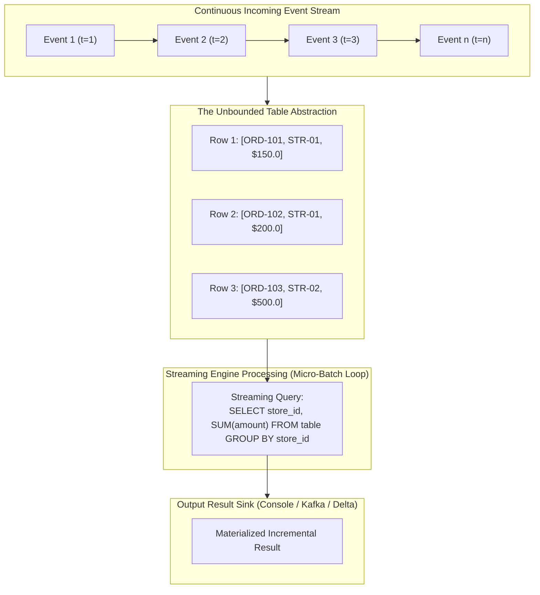
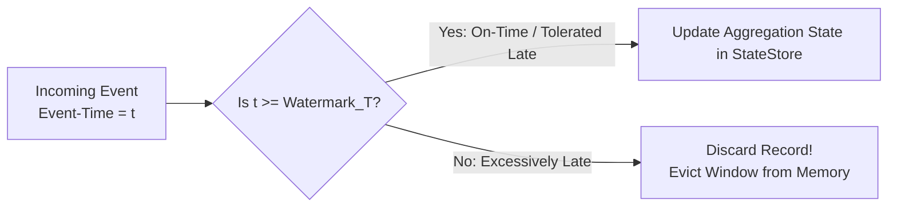
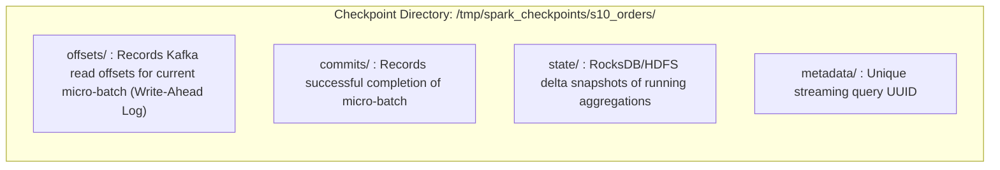

---
**Course:** Enterprise Real-Time Data Engineering  
**Instructor:** Mohamed Fouad Fakhruldeen ([Fakhr.me](https://fakhr.me))  
**Course Portal:** [fakhr.me/KafkaSpark](https://fakhr.me/KafkaSpark)  
**Code & Labs Repository:** [github.com/fakhruldeen/KafkaSpark](https://github.com/fakhruldeen/KafkaSpark)  
---

# Session S10: Student Comprehensive Handbook & Technical Textbook
## Spark Structured Streaming & Event-Time Watermarking
### The Unbounded Table Model, State Stores & Exactly-Once Semantics

---

## 1. Executive Summary & Learning Objectives
Real-time enterprise architectures require continuous processing of streaming data without sacrificing the rich relational semantics of SQL. **Apache Spark Structured Streaming** introduces a breakthrough unified programming model: treating continuous event streams as append-only **Unbounded Tables**.

In this module, you will master:
1. **The Unbounded Table Model:** Translating continuous stream processing into declarative SQL queries.
2. **Event-Time vs Processing-Time:** Handling network delays, out-of-order records, and device clock skew.
3. **Watermarking Calculus & State Eviction:** Formulating dynamic watermark thresholds ($\text{Watermark}_T = \max(\text{EventTime}) - \text{delayThreshold}$).
4. **State Stores & Write-Ahead Checkpointing:** Directory structure (`offsets/`, `commits/`, `state/`), exactly-once sink guarantees, and crash recovery.

---

## 2. The Unbounded Table Model

In Structured Streaming, a data stream is conceptualized as an infinitely growing table:



Every new event arriving from Kafka is appended as a new row to the Unbounded Table. At regular intervals (defined by `trigger`), the query executes incrementally over newly arrived rows, updating the result sink.

---

## 3. Event-Time Processing & Watermarking Mathematics

In distributed systems, the time an event occurred in the real world (**Event-Time**) rarely matches the time the event arrives at the processing cluster (**Processing-Time**):

```mermaid
timeline
    title Event-Time vs Processing-Time Timeline (Latency Skew)
    12:00 : Customer clicks 'Purchase' on mobile phone (Event-Time = 12:00)
    12:01 : Phone enters subway tunnel (Network disconnected)
    12:08 : Phone reconnects to 4G cell tower
    12:09 : Event arrives at Kafka broker (Processing-Time = 12:09)
```

If the analytical engine grouped data by processing time (arrival time), the mobile purchase would be attributed to the 12:09 window instead of the correct 12:00 window.

### 3.1 Watermarking Mathematical Formulation
To support stateful window aggregations without letting memory grow infinitely, Spark implements **Watermarking**:
$$\text{Watermark}_T = \max(\text{EventTime seen so far}) - \text{delayThreshold}$$



### Worked Numeric Walkthrough: Watermark Eviction
Suppose `delayThreshold = 10 minutes`:
1. $t_1$: Event arrives with $\text{EventTime} = \text{12:15}$.
   $$\text{Watermark}_1 = \text{12:15} - 10\text{ min} = \text{12:05}$$
   All windows ending after 12:05 remain active in memory.
2. $t_2$: Late event arrives with $\text{EventTime} = \text{12:08}$.
   Because $12:08 \ge 12:05$, the event is accepted and aggregated into the `[12:00 - 12:10]` window.
3. $t_3$: High event arrives with $\text{EventTime} = \text{12:30}$.
   $$\text{Watermark}_3 = \text{12:30} - 10\text{ min} = \text{12:20}$$
   The watermark advances to 12:20. Spark permanently commits and purges all windows ending before 12:20 from memory.
4. $t_4$: Severely delayed event arrives with $\text{EventTime} = \text{12:04}$.
   Because $12:04 < 12:20$, the event is dropped permanently.

---

## 4. Fault-Tolerance: Write-Ahead Logs & Checkpointing

Structured Streaming achieves **End-to-End Exactly-Once Processing** by pairing replayable sources (like Kafka) with idempotent sinks and write-ahead checkpoints:



### 4.1 Crash Recovery Sequence
1. Spark writes the target offsets to `offsets/<batch_id>`.
2. Executors process data and write to the output sink.
3. Spark writes `commits/<batch_id>`.
4. If a crash occurs between steps 2 and 3: upon restart, Spark reads `offsets/<batch_id>`, notices the missing commit file, and reprocesses the exact same micro-batch, ensuring zero dropped records.

---

## 5. Enterprise Production Troubleshooting Scenarios

### Scenario 1: State Store OOM on Missing Watermark
- **Symptom:** Streaming job runs stably for 48 hours, then crashes with `java.lang.OutOfMemoryError`.
- **Root Cause:** A `groupBy(window(...))` query was declared without `.withWatermark()`. Spark had to keep every temporal window open in memory indefinitely.
- **Remediation:** Enforce a strict watermark on event-time:
  ```python
  df.withWatermark("timestamp", "15 minutes").groupBy(F.window("timestamp", "10 minutes"))
  ```

---

## 6. Formal Technical Glossary & System Invariants

| Term | Formal Engineering Definition | Architectural Invariant |
|---|---|---|
| **Unbounded Table** | Conceptual model treating continuous streaming data as an infinite append-only table. | Enables identical declarative query semantics across streaming and batch. |
| **Watermark** | Dynamic trailing timestamp boundary determining when state for past windows is finalized. | Bounds state memory size by discarding excessively late records. |
| **trigger** | Configuration defining the timing of micro-batch execution intervals. | Determines the latency and resource consumption profile of the stream. |
| **checkpointLocation** | Durable directory storing offsets, commits, and state store snapshots. | Guarantees fault recovery and exactly-once processing across crashes. |

---

## 7. Canonical Documentation & Industry Certification Roadmap

### Canonical Documentation Links
- [Spark Structured Streaming Programming Guide](https://spark.apache.org/docs/latest/structured-streaming-programming-guide.html)
- [Databricks Guide: Production Structured Streaming](https://docs.databricks.com/en/structured-streaming/index.html)
- [Apache Spark Kafka Integration Reference](https://spark.apache.org/docs/latest/structured-streaming-kafka-integration.html)

### Certification Objectives Alignment (Databricks Associate Developer)
- **Domain 1: Streaming Fundamentals:** Unbounded table concept, micro-batch vs continuous processing.
- **Domain 2: Event-Time Processing:** Watermarks, tumbling/sliding windows, late data handling.
- **Domain 3: Fault-Tolerance:** Checkpointing, output modes (Append, Complete, Update).
