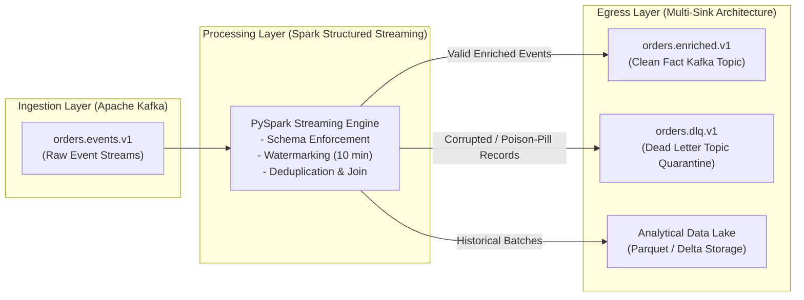
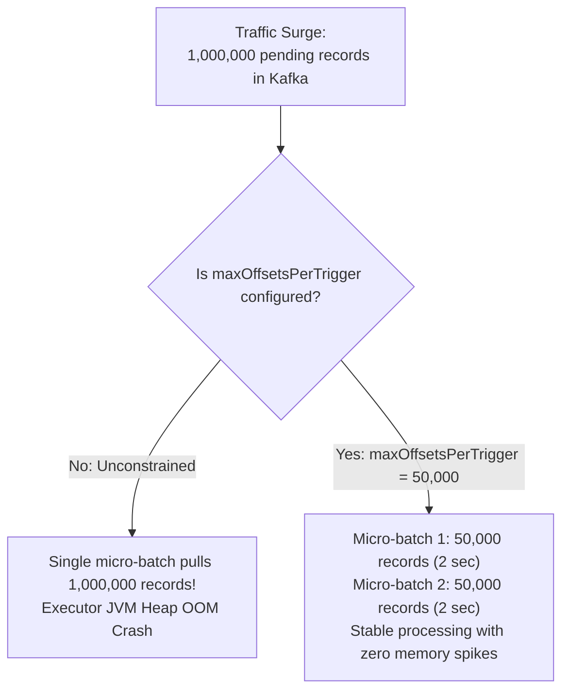
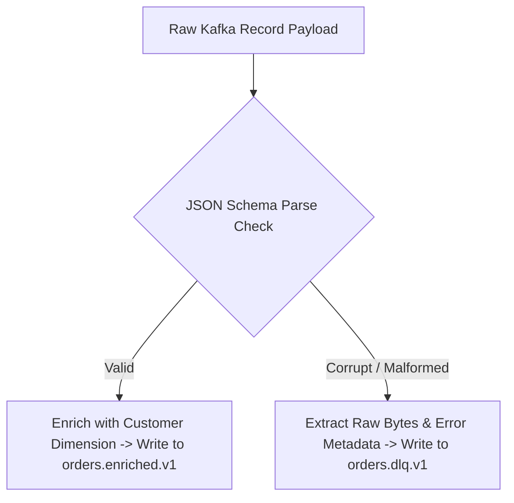

---
**Course:** Enterprise Real-Time Data Engineering  
**Instructor:** Mohamed Fouad Fakhruldeen ([Fakhr.me](https://fakhr.me))  
**Course Portal:** [fakhr.me/KafkaSpark](https://fakhr.me/KafkaSpark)  
**Code & Labs Repository:** [github.com/fakhruldeen/KafkaSpark](https://github.com/fakhruldeen/KafkaSpark)  
---

# Session S11: Student Comprehensive Handbook & Technical Textbook
## Kafka & Spark Pipeline Integration: End-to-End Architecture
### Production Ingestion, Backpressure Tuning & Dead Letter Topic Quarantine

---

## 1. Executive Summary & Learning Objectives
Connecting Apache Kafka with Apache Spark Structured Streaming forms the backbone of enterprise real-time data engineering. In production, raw event streams contain network jitter, unexpected traffic surges, and corrupted payloads. An enterprise data pipeline must provide robust flow control, defensive data validation, and automated error quarantine.

In this module, you will master:
1. **End-to-End Pipeline Architecture:** Connecting Kafka source topics $\rightarrow$ PySpark streaming transformations $\rightarrow$ Kafka sinks and analytical storage.
2. **Defensive Ingestion Parameters:** `failOnDataLoss = false`, `startingOffsets`, and partition-to-task mapping.
3. **Backpressure & Traffic Surge Control:** `maxOffsetsPerTrigger` and dynamic rate limiting.
4. **The Dead Letter Topic (DLT) Pattern:** Isolating malformed poison-pill records into quarantine topics without pipeline interruption.

---

## 2. End-to-End Real-Time Pipeline Architecture

The Nile Retail production streaming architecture integrates Kafka and Spark in a three-tier topology:



### 2.1 1:1 Partition-to-Task Mapping
When Spark reads from Kafka:
- Spark assigns exactly **one Spark Task per Kafka Partition**.
- If `orders.events.v1` has $6$ partitions, each micro-batch launches $6$ concurrent tasks on the Spark executors, pulling directly from the respective partition leader brokers.

---

## 3. Backpressure & Surge Protection Dynamics

During flash-sale promotional events or after an upstream network outage recovery, millions of accumulated events arrive in Kafka simultaneously. Without rate-limiting, Spark attempts to pull all pending records into a single massive micro-batch, causing JVM heap exhaustion, severe GC pauses, and pipeline failure.



### 3.1 Critical Ingestion Settings
```python
raw_stream = (
    spark.readStream
    .format("kafka")
    .option("kafka.bootstrap.servers", "localhost:9092")
    .option("subscribe", "orders.events.v1")
    .option("startingOffsets", "latest")
    .option("failOnDataLoss", "false")
    .option("maxOffsetsPerTrigger", 50000)
    .load()
)
```
- **`failOnDataLoss = false`:** Essential for production resilience. If Kafka retention deletes old log segments before Spark reads them (or if topic partitions are rebalanced), Spark logs a warning rather than crashing the streaming query.
- **`maxOffsetsPerTrigger = 50000`:** Caps the maximum number of records processed per micro-batch, providing predictable micro-batch durations.

---

## 4. The Dead Letter Topic (DLT) & Poison-Pill Quarantine Pattern

In high-throughput environments, records occasionally arrive with invalid JSON, corrupted characters, or mismatched schema versions. If a parser throws an uncaught exception, the streaming micro-batch fails, retries endlessly, and stalls the pipeline:



### 4.1 PySpark DLT Implementation
```python
# Parse JSON with permissive mode
parsed_df = raw_df.select(
    F.col("key").cast("string").alias("record_key"),
    F.col("value").cast("string").alias("raw_value"),
    F.from_json(F.col("value").cast("string"), schema).alias("data")
)

# Split into valid stream and dead letter stream
valid_stream = parsed_df.filter(F.col("data.order_id").isNotNull()).select("data.*")
dlq_stream = parsed_df.filter(F.col("data.order_id").isNull()).select(
    F.col("record_key").alias("key"),
    F.col("raw_value").alias("value")
)
```

---

## 5. Enterprise Production Troubleshooting Scenarios

### Scenario 1: `OffsetOutOfRangeException` on Broker Retention Expiry
- **Symptom:** Streaming query dies with `org.apache.kafka.clients.consumer.OffsetOutOfRangeException`.
- **Root Cause:** Upstream brokers pruned expired log segments while the Spark streaming application was stopped for maintenance, and `failOnDataLoss` was left at default `true`.
- **Remediation:** Configure `.option("failOnDataLoss", "false")`.

---

## 6. Formal Technical Glossary & System Invariants

| Term | Formal Engineering Definition | Architectural Invariant |
|---|---|---|
| **failOnDataLoss** | Spark Kafka source configuration defining behavior when partition offsets are missing. | Setting to false prevents fatal query termination upon broker retention log pruning. |
| **Dead Letter Queue** | Secondary Kafka topic used to quarantine unparseable records for offline inspection. | Guarantees continuous 24/7 stream processing without poison-pill blocking. |
| **backpressure** | Flow-control mechanism matching consumption rate to downstream processing capacity. | Prevents executor JVM heap exhaustion during sudden upstream traffic spikes. |
| **End-to-End** | Architectural property guaranteeing delivery across the entire pipeline from ingestion to egress. | Combines replayable sources, stateful processing, and idempotent sinks. |

---

## 7. Canonical Documentation & Industry Certification Roadmap

### Canonical Documentation Links
- [Structured Streaming + Kafka Integration Guide](https://spark.apache.org/docs/latest/structured-streaming-kafka-integration.html)
- [Enterprise Dead Letter Queue Design Patterns](https://www.confluent.io/blog/error-handling-patterns-in-kafka/)
- [Databricks: Production Kafka Streaming Best Practices](https://docs.databricks.com/en/structured-streaming/kafka.html)

### Certification Objectives Alignment (Databricks Associate Developer)
- **Domain 1: Pipeline Integration:** Reading from Kafka, extracting keys and values.
- **Domain 2: Resilience:** Checkpointing, managing offsets, handling missing partitions.
- **Domain 3: Multi-Sink Topologies:** Writing back to Kafka, formatting JSON/Avro payloads.
