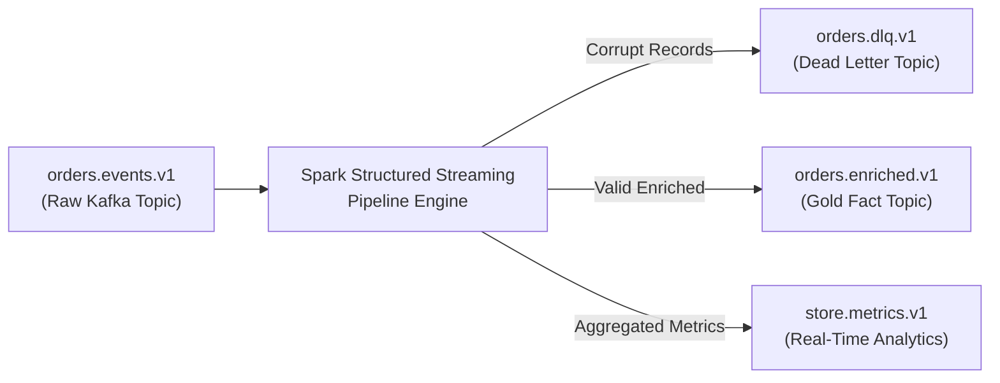

---
**Course:** Enterprise Real-Time Data Engineering  
**Instructor:** Mohamed Fouad Fakhruldeen ([Fakhr.me](https://fakhr.me))  
**Course Portal:** [fakhr.me/KafkaSpark](https://fakhr.me/KafkaSpark)  
**Code & Labs Repository:** [github.com/fakhruldeen/KafkaSpark](https://github.com/fakhruldeen/KafkaSpark)  
---

# Session S11: Hands-On Lab Walkthrough & CLI Guide
## Kafka & Spark Pipeline Integration (End-to-End Streaming)

---

## 1. Lab Objectives
In this hands-on engineering lab, you will deploy a production-grade End-to-End real-time data pipeline integrating Kafka and Spark:
1. Ingest raw retail order events from Kafka topic `orders.events.v1`.
2. Implement schema validation and defensive error handling: quarantine corrupt poison-pill records into a Dead Letter Topic (`orders.dlq.v1`).
3. Cleanse valid records, enrich them with customer dimensions, and compute 1-minute tumbling window metrics.
4. Write enriched business facts back to Kafka topic `orders.enriched.v1` and analytical summaries to `store.metrics.v1`.
5. Ensure end-to-end exactly-once processing guarantees and execute automated test validation.

---

## 2. Environment Setup & Pipeline Topics Verification
Verify the lab environment and create required Kafka topics:

```bash
cd "${LAB_ROOT:-delivery_materials/00_Lab}" 2>/dev/null || cd 00_Lab || cd ../../00_Lab

source .venv/bin/activate
if [ -d "${HOME}/.local/share/jvm/jdk-17.0.21+9" ]; then
  export JAVA_HOME="${HOME}/.local/share/jvm/jdk-17.0.21+9"
fi
export PATH="${JAVA_HOME:-/usr/lib/jvm/default-java}/bin:${PATH}"
export PYSPARK_PYTHON="$(pwd)/.venv/bin/python"
export PYSPARK_DRIVER_PYTHON="$(pwd)/.venv/bin/python"

# Create output topics if not existing
docker exec -it kafka1 /opt/kafka/bin/kafka-topics.sh   --bootstrap-server kafka1:9092   --create --if-not-exists   --topic orders.enriched.v1 --partitions 3 --replication-factor 3

docker exec -it kafka1 /opt/kafka/bin/kafka-topics.sh   --bootstrap-server kafka1:9092   --create --if-not-exists   --topic orders.dlq.v1 --partitions 3 --replication-factor 3

docker exec -it kafka1 /opt/kafka/bin/kafka-topics.sh   --bootstrap-server kafka1:9092 --list
```

---

## 3. Step 1: Dissecting the Production Integration Code `python/s11_pipeline.py`
Inspect the architecture of `python/s11_pipeline.py`:



Key engineering practices applied:
1. **Defensive Ingestion (`failOnDataLoss=false`):**
   ```python
   raw_df = (
       spark.readStream
       .format("kafka")
       .option("kafka.bootstrap.servers", "localhost:9092")
       .option("subscribe", "orders.events.v1")
       .option("startingOffsets", "latest")
       .option("failOnDataLoss", "false")
       .option("maxOffsetsPerTrigger", 50000)
       .load()
   )
   ```
2. **Dead Letter Routing:**
   Corrupt JSON records that fail schema parsing are routed to `orders.dlq.v1` with the raw payload and error timestamp, preventing pipeline termination.
3. **Kafka Sink Writing:**
   ```python
   sink_query = (
       enriched_df
       .selectExpr("CAST(order_id AS STRING) AS key", "to_json(struct(*)) AS value")
       .writeStream
       .format("kafka")
       .option("kafka.bootstrap.servers", "localhost:9092")
       .option("topic", "orders.enriched.v1")
       .option("checkpointLocation", "/tmp/spark_checkpoints/s11_enriched")
       .start()
   )
   ```

---

## 4. Step 2: Running the Integrated Pipeline
Start the end-to-end pipeline in the background:

```bash
python python/s11_pipeline.py &
PIPELINE_PID=$!
echo "Pipeline running with PID: ${PIPELINE_PID}"
```

Produce test events including one valid record and one malformed poison-pill:

```bash
printf '{"order_id": "ORD-901", "customer_id": 101, "amount": 199.99, "timestamp": "2026-11-07T12:00:00Z"}\nMALFORMED_CORRUPT_JSON_PAYLOAD\n' | docker exec -i kafka1 /opt/kafka/bin/kafka-console-producer.sh --bootstrap-server kafka1:9092 --topic orders.events.v1
```

Verify that the valid record arrives in `orders.enriched.v1`:

```bash
docker exec -it kafka1 /opt/kafka/bin/kafka-console-consumer.sh   --bootstrap-server kafka1:9092   --topic orders.enriched.v1   --from-beginning --max-messages 1 --timeout-ms 5000
```

Verify that the malformed payload is safely trapped in `orders.dlq.v1`:

```bash
docker exec -it kafka1 /opt/kafka/bin/kafka-console-consumer.sh   --bootstrap-server kafka1:9092   --topic orders.dlq.v1   --from-beginning --max-messages 1 --timeout-ms 5000
```

Stop the background pipeline:
```bash
kill -SIGTERM ${PIPELINE_PID}
```

---

## 5. Step 3: Automated Testing with Pytest
Execute the pipeline integration unit and contract tests:

```bash
pytest tests/test_s11_pipeline.py -v
```

**Expected Output:**
```text
tests/test_s11_pipeline.py::test_valid_record_reaches_enriched_topic PASSED   [ 50%]
tests/test_s11_pipeline.py::test_poison_pill_diverted_to_dlq PASSED          [100%]
============================== 2 passed in 6.18s ===============================
```

---

## 6. Step 4: Master Verification Script
Run the verification script:

```bash
bash Trainer/S11_05_verify_s11.sh
```

**Expected Output:**
```text
[PASS] S11 Kafka & Spark Pipeline Integration fully certified.
```

---

## 🌟 Gold Stretch Challenge: Backpressure and Rate-Limiting Tuning
> **Distinguished Engineer Challenge:** If you complete the core lab before time expires, tune streaming backpressure under an extreme traffic surge:
1. Inject 500,000 synthetic records into `orders.events.v1` in under 10 seconds.
2. Observe Spark Executor memory and GC pause behavior when `maxOffsetsPerTrigger` is unconstrained.
3. Configure `spark.streaming.backpressure.enabled=true` and `spark.streaming.kafka.maxRatePerPartition=1000`.
4. Rerun the surge test and inspect the Spark UI (`http://localhost:4040`) to verify that micro-batch processing time stabilizes below the micro-batch trigger interval.
