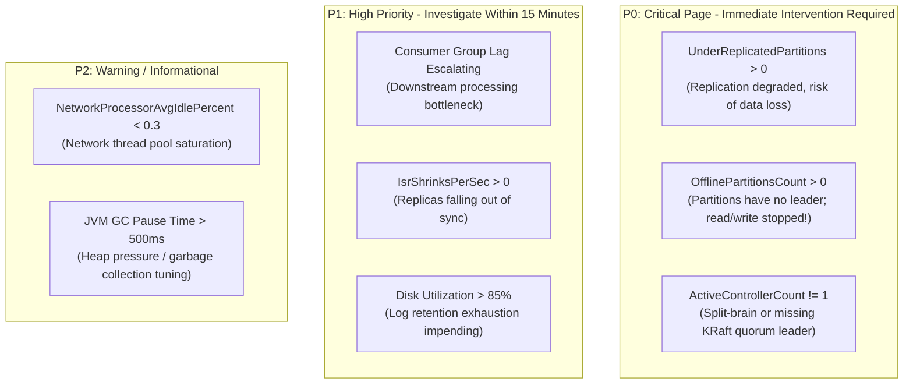
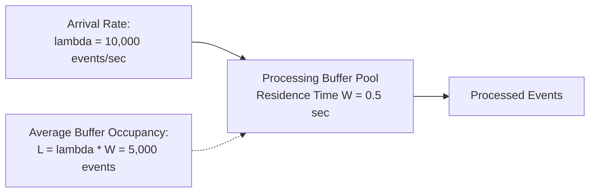
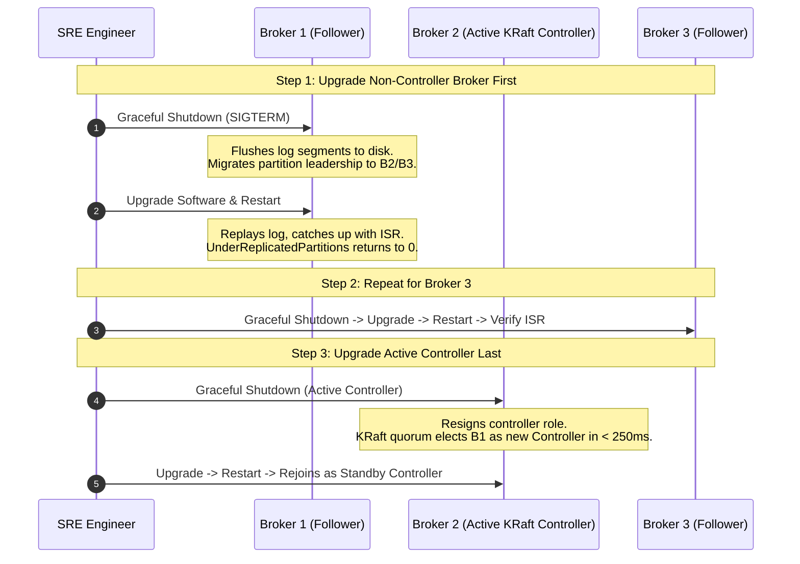
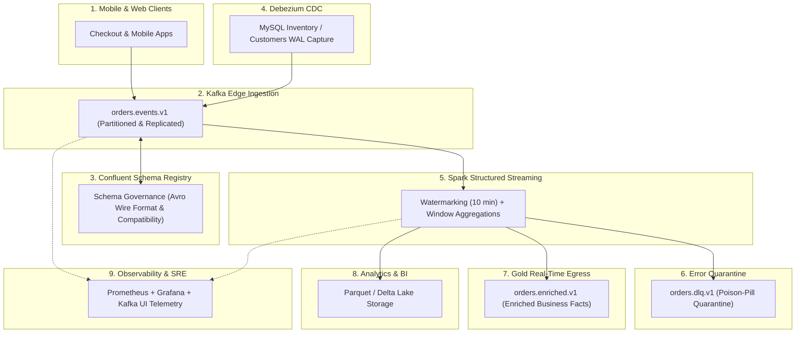

---
**Course:** Enterprise Real-Time Data Engineering  
**Instructor:** Mohamed Fouad Fakhruldeen ([Fakhr.me](https://fakhr.me))  
**Course Portal:** [fakhr.me/KafkaSpark](https://fakhr.me/KafkaSpark)  
**Code & Labs Repository:** [github.com/fakhruldeen/KafkaSpark](https://github.com/fakhruldeen/KafkaSpark)  
---

# Session S12: Student Comprehensive Handbook & Technical Textbook
## Production Operations, Monitoring & Capstone Defense
### Cluster Observability, JMX Metrics Triage & Chaos Engineering

---

## 1. Executive Summary & Learning Objectives
Deploying streaming pipelines into enterprise production requires transitioning from software development to **Day-2 Operations**. A resilient data engineer must understand how to monitor cluster vitals, triage distributed alerts, conduct chaos drills, plan capacity using queueing theory, and execute zero-downtime rolling upgrades.

In this capstone module, you will master:
1. **The Production JMX Metrics Priority Matrix:** Triaging P0, P1, and P2 alerts (UnderReplicatedPartitions, OfflinePartitionsCount, Consumer Lag).
2. **Chaos Engineering & Resilience Verification:** Inducing broker failures, network partitions, and verifying automatic leader election.
3. **Queueing Theory & Capacity Planning:** Applying **Little's Law** ($L = \lambda \times W$) to size broker heaps, page caches, and network threads.
4. **Zero-Downtime Rolling Restarts:** Executing safe rolling maintenance without message loss or consumer interruption.
5. **The Nile Retail 9-Stage Architecture:** Defending the end-to-end capstone platform across acceptance criteria T1 through T5.

---

## 2. Production JMX Metrics Triage Matrix

Kafka brokers and Spark executors expose hundreds of telemetry metrics via **Java Management Extensions (JMX)**. Enterprise Site Reliability Engineers (SREs) prioritize metrics into three distinct operational tiers:

| Metric Name | JMX MBean Object Name | Target Invariant | Action if Breached |
|---|---|---|---|
| **UnderReplicatedPartitions** | `kafka.server:type=ReplicaManager,name=UnderReplicatedPartitions` | **Must be 0** | Check broker liveness, network connectivity, and disk I/O wait. |
| **OfflinePartitionsCount** | `kafka.controller:type=KafkaController,name=OfflinePartitionsCount` | **Must be 0** | Immediate disaster recovery; verify broker quorum and partition logs. |
| **ActiveControllerCount** | `kafka.controller:type=KafkaController,name=ActiveControllerCount` | **Must be exactly 1** | Investigate KRaft voter health; resolve split-brain network partition. |
| **Consumer Lag** | `kafka.consumer:type=consumer-fetcher-manager-metrics,name=records-lag-max` | Bounded & stable | Scale consumer group instances or increase `maxOffsetsPerTrigger`. |

---

## 3. Capacity Planning & Queueing Theory: Little's Law

To size Kafka clusters and prevent buffer overflow, engineers apply **Little's Law** from operational queueing theory:
$$L = \lambda \times W$$
- $L$: Average number of events residing within the system (buffer occupancy).
- $\lambda$: Long-term average arrival rate of events (events per second).
- $W$: Average processing duration per event (residence time in seconds).

### Worked Numeric Sizing Example
Suppose Nile Retail processes $\lambda = 50,000\text{ orders/sec}$ during Black Friday sales. Each message is $1\text{ KB}$. Downstream Spark Structured Streaming micro-batches execute with duration $W = 4\text{ seconds}$.
1. Average in-memory buffer occupancy:
   $$L = 50,000 \times 4 = 200,000\text{ records}$$
2. Physical memory bandwidth required in Page Cache:
   $$M = 200,000 \times 1\text{ KB} = 200\text{ MB}$$
3. Network ingress throughput per second:
   $$\text{Ingress} = 50,000 \times 1\text{ KB} = 50\text{ MB/s} \ (400\text{ Mbps})$$
4. With a $3\times$ replication factor, inter-broker replication adds:
   $$\text{Replication Traffic} = 50\text{ MB/s} \times 2 = 100\text{ MB/s}$$
   Total broker network capacity required: $\ge 150\text{ MB/s}$ ($1.2\text{ Gbps}$ full-duplex NIC).

---

## 4. Zero-Downtime Rolling Cluster Maintenance

Upgrading Kafka brokers or patching underlying Linux kernels in production must never cause client write errors or consumer disconnection:

---

## 5. Nile Retail Capstone Architecture & Defense Criteria (T1–T5)

The capstone project synthesizes all 12 modules into a cohesive production platform:

### Capstone Acceptance Test Suite (T1–T5)
To pass the technical capstone defense, the candidate's implementation must pass all automated verification tests:
- **T1: Schema Registry Contract Enforcement:** Publishing a record with an invalid schema is rejected with HTTP 409 Conflict.
- **T2: Debezium CDC Replication:** An `INSERT` into the MySQL database is captured and streamed to Kafka in $< 1\text{ second}$.
- **T3: Spark Watermarked Streaming:** Out-of-order events within the 10-minute threshold are correctly aggregated; events older than 10 minutes are evicted.
- **T4: Poison-Pill Routing:** Corrupted JSON records are diverted to `orders.dlq.v1` with zero streaming query downtime.
- **T5: Chaos Resilience:** Stopping any single Kafka broker preserves continuous producer publishing and zero consumer data loss.

---

## 6. Formal Technical Glossary & System Invariants

| Term | Formal Engineering Definition | Architectural Invariant |
|---|---|---|
| **UnderReplicatedPartitions** | Count of topic partitions whose current active replica count is less than target replication factor. | Must be zero in healthy production clusters. |
| **Consumer Lag** | Difference between partition Log End Offset and consumer group committed offset. | Indicates downstream processing delay or consumer capacity exhaustion. |
| **JMX** | Java Management Extensions protocol exposing broker runtime telemetry and performance counters. | Standard interface for Prometheus and Datadog monitoring agents. |
| **Chaos** | Discipline of experimenting on a system in production to build confidence in capability to withstand turbulent conditions. | Validates zero-downtime failover under hardware and network faults. |

---

## 7. Canonical Documentation & Industry Certification Roadmap

### Canonical Documentation Links
- [Apache Kafka Monitoring and JMX Metrics Reference](https://kafka.apache.org/documentation/#monitoring)
- [Confluent Production Sizing and Capacity Planning Guide](https://docs.confluent.io/platform/current/kafka/sizing.html)
- [Chaos Engineering: Principles and Practices](https://principlesofchaos.org/)

### Certification Objectives Alignment (CCDAK & Databricks)
- **Domain 1: Operations:** JMX metrics monitoring, alert threshold triage, rolling restarts.
- **Domain 2: Disaster Recovery:** Controller failover, partition reassignment, replication debugging.
- **Domain 3: End-to-End Governance:** Multi-system data lineage, security, capstone compliance.
