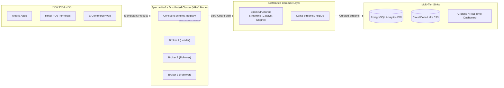

# Enterprise Real-Time Data Engineering
## Apache Kafka Core, Confluent Developer & Apache Spark (Structured Streaming)
**Lead Instructor:** Mohamed Fouad Fakhruldeen ([Fakhr.me](https://fakhr.me))  
**Course Portal:** [fakhr.me/KafkaSpark](https://fakhr.me/KafkaSpark)  
**Code & Labs Repository:** [github.com/fakhruldeen/KafkaSpark](https://github.com/fakhruldeen/KafkaSpark)  
**Audience:** Senior Software Engineers, Data Engineers, Solution Architects, Technical Leads

---

## 🏛️ Course Architecture Blueprint



---

## ⚡ 1-Minute Automated Quick Start

Clone this repository and run the automated lab environment bootstrap:

```bash
# 1. Clone the repository
git clone https://github.com/fakhruldeen/KafkaSpark.git
cd KafkaSpark/00_Lab_Environment

# 2. Run automated setup (downloads Spark JARs, installs Python packages, pulls Docker images)
./setup_environment.sh

# 3. Start the Kafka KRaft cluster
docker compose up -d

# 4. Open Kafka UI in your browser
# URL: http://localhost:8080
```

---

## 📅 5-Day Curriculum Roadmap & Navigation

### [Day 1: Apache Kafka Architecture & Storage Internals](01_Day_1_Kafka_Foundations/README.md)
* **[S00: Course Launch & Workstation Readiness](01_Day_1_Kafka_Foundations/S00_Refresh/README.md)**: Refresher on distributed computing, the Latency Spectrum, CAP & PACELC theorems, and workstation environment validation.
* **[S01: Kafka Core Foundations & Architecture](01_Day_1_Kafka_Foundations/S01_Kafka_Foundations/README.md)**: Architectural decoupling, immutable Commit Log, OS PageCache, Linux Zero-Copy `sendfile(2)`, and KRaft consensus mode.
* **[S02: Topics, Partitions & Replication](01_Day_1_Kafka_Foundations/S02_Topics_Partitions_Replication/README.md)**: MurmurHash2 partitioning algorithms, physical segment files (`.log`, `.index`, `.timeindex`), In-Sync Replicas (ISR) quorums, and failover mechanics.

---

### [Day 2: High-Throughput Production, Reliable Consumption & Schemas](02_Day_2_Producers_Consumers_Contracts/README.md)
* **[S03: Producer Internals & Delivery Semantics](02_Day_2_Producers_Consumers_Contracts/S03_Producer_Internals_Delivery_Semantics/README.md)**: RecordAccumulator memory management, BufferPool allocation, acks quorums, and idempotent producer sequence deduplication.
* **[S04: Consumer Groups, Rebalancing & Reliability](02_Day_2_Producers_Consumers_Contracts/S04_Consumer_Internals_Rebalance_Reliability/README.md)**: Consumer offset commits, Eager vs. CooperativeSticky incremental rebalance, and Dead Letter Topics (DLT).
* **[S05: Confluent Schema Registry & Data Contracts](02_Day_2_Producers_Consumers_Contracts/S05_Confluent_Schema_Registry_Data_Contracts/README.md)**: Apache Avro wire format (Magic Byte + 4-byte Schema ID), compatibility rules (BACKWARD, FORWARD, FULL), and data contracts.

---

### [Day 3: Distributed Data Integration & Real-Time Stream Processing](03_Day_3_Integration_and_Stream_Processing/README.md)
* **[S06: Kafka Connect & Distributed Data Integration](03_Day_3_Integration_and_Stream_Processing/S06_Kafka_Connect_Data_Integration/README.md)**: Distributed worker clusters, Source and Sink connector plugins, REST API administration, and log-compacted internal storage topics.
* **[S07: Kafka Streams & ksqlDB Architecture](03_Day_3_Integration_and_Stream_Processing/S07_Kafka_Streams_and_ksqlDB/README.md)**: Stream-Table duality (KStream vs. KTable), local embedded RocksDB state stores, tumbling/hopping time windows, and continuous SQL stream processing.

---

### [Day 4: Large-Scale Distributed Processing & Spark Structured Streaming](04_Day_4_Apache_Spark_and_Streaming/README.md)
* **[S08: Apache Spark Architecture & Catalyst Optimization](04_Day_4_Apache_Spark_and_Streaming/S08_Apache_Spark_and_PySpark_DataFrames/README.md)**: Driver/Executor topologies, Catalyst optimizer compilation stages, and Project Tungsten off-heap memory management.
* **[S09: Spark SQL, Advanced Joins & Data Skew Optimization](04_Day_4_Apache_Spark_and_Streaming/S09_Spark_SQL_and_Advanced_Joins/README.md)**: BroadcastHashJoin vs. SortMergeJoin, network shuffle mitigation, data skew detection, and key salting techniques.
* **[S10: Spark Structured Streaming & Event-Time Processing](04_Day_4_Apache_Spark_and_Streaming/S10_Spark_Structured_Streaming/README.md)**: Unbounded table stream processing, event-time watermarking, stateful window aggregations, and Write-Ahead Log (WAL) checkpointing.

---

### [Day 5: Enterprise Pipeline Integration, Monitoring & Production Defense](05_Day_5_Enterprise_Pipeline_and_Production/README.md)
* **[S11: Kafka & Spark Pipeline Integration](05_Day_5_Enterprise_Pipeline_and_Production/S11_Kafka_Spark_Pipeline_Integration/README.md)**: Nile Retail end-to-end streaming architecture, schema validation, real-time fraud detection, and multi-sink synchronization.
* **[S12: Production Operations, Monitoring & Capstone Defense](05_Day_5_Enterprise_Pipeline_and_Production/S12_Production_Operations_Monitoring_and_Capstone/README.md)**: Production observability mesh, JMX Golden Signals, Prometheus scraping, Grafana dashboards, and capstone presentation.

---

## 💼 Enterprise Case Study: Nile Retail

Throughout the 40-hour hands-on curriculum, all exercises converge on solving the real-time operational challenge of **Nile Retail** — a premier hybrid retail enterprise handling **4,000+ orders per minute** across 300 physical stores and national e-commerce channels. Trainees design, build, test, and defend the fault-tolerant streaming architecture that replaced legacy overnight batch processing.

---

## 🛠️ Workstation Hardware & Software Requirements

| Component | Minimum Specification | Recommended Specification |
|---|---|---|
| **CPU** | 4 Physical Cores (x86_64 or Apple Silicon) | 8 Cores (Intel i7/i9, AMD Ryzen, Apple M-series) |
| **RAM** | 16 GB Physical RAM | 24–32 GB RAM |
| **Disk Space** | 20 GB Free SSD Space | 40 GB Free NVMe SSD |
| **Operating System** | Ubuntu 22.04/24.04 LTS, macOS 13+, Windows 10/11 with WSL 2 | Ubuntu 24.04 LTS or macOS Sequoia |
| **Docker Engine** | Docker Desktop 4.25+ or Docker Engine 24.0+ | Docker Engine 26+ with Compose v2 |
| **Python** | Python 3.10 to 3.12 | Python 3.11 |
| **Java** | OpenJDK 17 LTS (required for PySpark) | OpenJDK 17 LTS |

---

## 📜 License & Copyright
© 2026 **Mohamed Fouad Fakhruldeen** ([Fakhr.me](https://fakhr.me)). All Rights Reserved.  
Course materials distributed exclusively to registered trainees of the Enterprise Real-Time Data Engineering training program.
